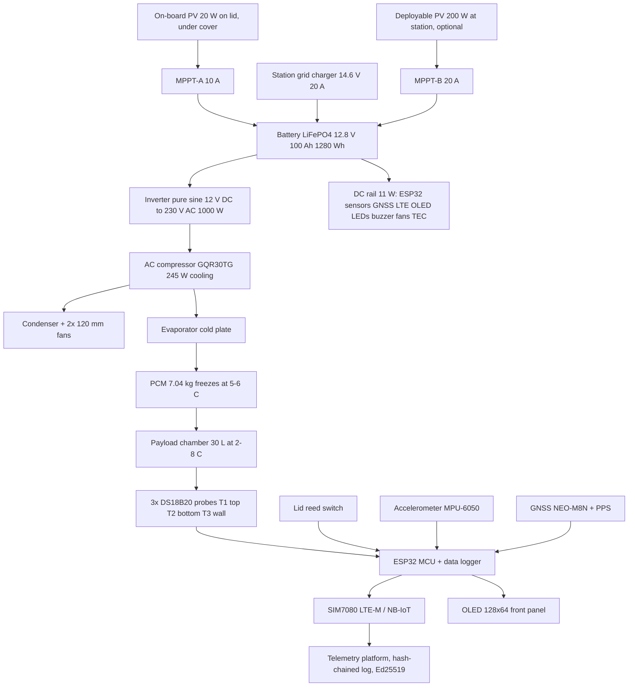

# detail.md — Dimensions and calculations (compact revision · AC-compressor power update)

> This revision replaces the earlier 12 V DC-compressor power system with a 220–240 V AC compressor (GQR30TG) fed from a 12.8 V 100 Ah LiFePO₄ battery through a pure-sine inverter. The payload core, insulation, PCM, and cold-box geometry are unchanged and still exactly 30.0 L. Where numbers here differ from `Case_Study_5_Solution_Analysis.md` or the wokwi sketch, these control.
> Labels: [benchmark] = figure from the brief. [estimate] = our own calculation, assumptions stated. [verify] = manufacturer datasheet required before build.
> Notation: period (.) is the decimal separator. En dashes appear only in technical ranges such as 2–8 °C.

## 0. The concept in short

The payload chamber is fixed at 40 × 25 × 30 cm = 30.0 L [benchmark]. Every other layer is built around it and nothing eats into that volume. Vacuum insulation panels (VIP) at 2.5 cm keep the cold box compact at 45.8 × 33.4 × 38.3 cm.

The power system changes in this revision:

| | Previous revision | This revision |
|---|---|---|
| Compressor | 12/24 V DC, BD35F class | **GQR30TG, 220–240 V AC, 245 W cooling** [verify] |
| Power path | battery → compressor (DC) | battery → **inverter 12 V DC → 230 V AC** → compressor |
| Battery | LiFePO₄ 12 V 20 Ah (240 Wh) | **LiFePO₄ 12.8 V 100 Ah (1,280 Wh)** |
| PV panel | 200 W, separate at the station | **20 W compact, bonded on the lid top, under a protective cover** |
| Station charging | PV via MPPT | **grid AC charger (baseline) or deployable PV kit (option)**; on-board PV is a trickle/range extender only |
| MPPT | 20 A | **10 A (on-board PV) + 20 A (station PV input)** |

The box remains two tiers stacked vertically:
- **Cold box (tier 2, top):** insulated payload chamber with lid, PCM plates, evaporator, circulation fan.
- **Machine tier (tier 1, bottom):** AC compressor, condenser, 100 Ah battery, inverter, MPPT, fuse panel, electronics.

Colour identity: **dark charcoal grey body (RAL 7021)** with a **Sunlight Yellow accent stripe (RAL 1023)**. Interior liner food-grade off-white. Front OLED and LEDs give status without opening the lid. A dark skin absorbs more sun than a light one; the solar-gain line in §3.4 is sized for the dark skin and the SOP adds shade parking and the tarpaulin rule.

## 1. System diagram



## 2. Step 1: the payload chamber

40 cm × 25 cm × 30 cm = 30,000 cm³ = **30.0 L** [benchmark].

Why this shape: 30 cm height fits three stacked vaccine trays (each ≤ 90 mm tall), 25 cm width is reachable from one side, and the 1.6:1 length ratio stays stable on a boat or motorbike.

The PCM plates sit between the payload and the liner, the liner wraps them, and the insulation and skins sit outside the liner. After assembly the usable space is still 40 × 25 × 30 = 30.0 L. The core is a hard constraint; the walls flex around it, never the other way round.

**Lid:** 415 × 285 mm opening, rear-hinged on the long edge, swings open to ~120° and stays open without a prop rod. Closed by two cam-action stainless latches (released simultaneously) and secured with a centre-front hasp for a wire tamper seal or padlock. A broken or missing seal is flagged as a custody event in the hash chain. The lid carries a double-lip EPDM gasket for IPX4 rain sealing.

**Interior liner colour:** food-grade natural PP (off-white, no pigment) for visual hygiene inspection. A 20 g silica gel sachet is clipped to the lid interior corner and replaced annually.

## 3. Step 2: the heat load

### 3.1 The wall build-up, inside to out (unchanged)

| Layer | Thickness | Where it counts |
|---|---|---|
| Payload | 30.0 L core | the volume itself |
| PCM plates (two long walls + floor) | 13 mm | +1.3 cm to Z, +2.6 cm to Y |
| Liner, food-grade PP | 2 mm per face | +0.4 cm per axis |
| Evaporator plate | 12 mm | floor only, under the PCM |
| VIP panels | 25 mm per face | +5.0 cm per axis |
| HDPE skin | 2 mm per face | +0.4 cm per axis |

### 3.2 Wall areas (unchanged)

Inner cavity (inside the liner): 0.40 × 0.276 × 0.313 m
A_in = 2(0.40×0.276) + 2(0.40×0.313) + 2(0.276×0.313) = 0.221 + 0.250 + 0.173 = **0.644 m²**

External cold box: 0.458 × 0.334 × 0.383 m
A_out = 2(0.458×0.334) + 2(0.458×0.383) + 2(0.334×0.383) = 0.306 + 0.351 + 0.256 = **0.913 m²**

Mean area: A = √(0.644 × 0.913) = **0.77 m²**

### 3.3 Conduction through the walls (unchanged)

VIP thermal resistance: R = L / k = 0.025 / 0.0075 = **3.33 m²·K/W** (aged k, sized for the whole service life).

```
Q = ΔT × A / R = 35 × 0.77 / 3.33 = 8.1 W
```

Add 15% for hinges, fasteners and small bridges: **9 W** at design ambient 40 °C. At 42 °C (ΔT 37): **10 W**.

### 3.4 Total heat over 24 h passive (power off)

| Heat source | Working | Energy |
|---|---|---|
| Wall conduction | 9 W × 86,400 s | 778 kJ |
| Lid openings | 4 × 30 kJ | 120 kJ |
| Internal fan and sensors | 1 W × 86,400 s | 86 kJ |
| Solar gain on the dark skin | 4 W × 12 sunlit h | 173 kJ |
| Payload | pre-cooled to 4 °C at the station | 0 |
| **Total** | | **≈ 1.16 MJ** |

The solar-gain line assumes the RAL 7021 skin (solar absorptance α ≈ 0.9 [estimate]) with shade-parking SOP. A white skin would cut this roughly in half; the dark colour is kept for brand consistency, and the 34% PCM margin absorbs the difference. The 30 kJ per opening covers inner-surface warming and payload handling.

## 4. Step 3: the PCM (unchanged)

```
m = Q / λ = 1,160,000 / 220,000 = 5.3 kg   (theoretical minimum)
```

| Plate | Dimensions | Volume | Mass |
|---|---|---|---|
| A, two long walls (×2) | 40 × 31.3 × 1.3 cm | 1.63 L each | 2.44 kg each |
| B, floor (×1) | 40 × 27.6 × 1.3 cm | 1.44 L | 2.15 kg |
| **Total** | | **4.70 L** | **7.04 kg** |

- Cold capacity: 7.04 kg × 220 kJ/kg = **1,549 kJ** against a 1,157 kJ demand → **34% margin**. The margin covers PCM aging, 42 °C days, extra lid openings and operators who are less disciplined than the SOP.
- Salt hydrate, melt 5–6 °C, density 1.5 kg/L [verify λ and cycling stability against the supplier datasheet].
- The plates total 4.7 L and live inside the wall zone. Payload stays 30.0 L.

**Holdover statement:** ≥ 24 h passive is an *estimate that holds only under the stated test profile* — 38–42 °C ambient, pre-cooled payload at 4 °C, ≤ 4 lid openings, sensors per the temperature-mapping plan. It is not a guarantee until the laboratory qualification in the essay's validation plan demonstrates it.

## 5. Step 4: the cooler — GQR30TG via inverter

### 5.1 What the datasheet gives and what it does not

| Parameter | Value | Status |
|---|---|---|
| Model | GQR30TG | given |
| Rated voltage | 220–240 V AC, 50/60 Hz | given |
| Cooling capacity | 245 W | given — **this is cooling duty, NOT electrical input** |
| Motor | 1/10 HP (≈ 75 W shaft), RSIR | given |
| Starter | PTC or current relay | given |
| Application | medium back pressure | given |
| Electrical input power | **not provided** | **[verify]** |
| Running current / LRA | **not provided** | **[verify]** |
| Refrigerant + charge | **not provided** | **[verify]** |
| Condenser requirement | **not provided** | **[verify]** |

Scenario logic: 245 W is assumed to be the rating at medium-back-pressure conditions (evap ≈ −10 °C, cond ≈ 45 °C). At our design points (evap −8 °C to freeze the 5–6 °C PCM, cond 50–55 °C at 40 °C ambient) capacity derates slightly.

### 5.2 Electrical input scenarios [estimate — three scenarios, datasheet to resolve]

| Scenario | Input power | COP at design | Net capacity (−10 W leak) | PCM recharge (1,549 kJ) | Daily energy (§6.5) |
|---|---|---|---|---|---|
| Optimistic | 130 W | 1.69 | 212 W | 2.0 h | 756 Wh |
| **Baseline** | **145 W** | **1.52** | **210 W** | **2.1 h** | **810 Wh** |
| Pessimistic | 180 W | 1.22 | 187 W | 2.3 h | 928 Wh |

Starting current: RSIR with PTC starter typically draws 3–4× running current for 0.2–0.5 s. At baseline 0.65 A running [estimate], start ≈ 2.5 A AC ≈ 600 VA. The inverter must still be sized for the datasheet LRA — this is the single most important [verify] item in the electrical chain.

### 5.3 Why AC over DC (tradeoff stated, not hidden)

A DC compressor would skip the inverter's ~10% loss and its surge risk. The GQR30TG baseline is kept because it is inexpensive, locally serviceable, and available in the target regions; the energy penalty is priced in §6 and covered by station charging. If the pilot shows the inverter is the dominant failure or the energy margin is too thin, the fallback is a 12/24 V DC compressor of equal capacity with the battery and panel unchanged.

### 5.4 Condenser resize

Heat rejection = capacity + input ≈ 220 + 145 = **365 W** [baseline scenario].

| Spec | Value |
|---|---|
| Type | wire-tube, copper Ø6, 3 rows |
| Face | **280 × 150 mm**, on the Y+ wall of the machine tier |
| Wire surface | ≈ 0.62 m², UA ≈ 35 W/K |
| Airflow needed | ≈ 64 CFM through the core |
| Fans | **2 × 120 mm axial** (65 CFM free air each), ≈ 90 CFM free |
| Fan power | 2 × 2.4 W = 4.8 W (DC rail) |
| Interlock | firmware will not start the compressor when either tach reads zero |

### 5.5 TEC trim (kept, DC side)

The 40 × 40 mm Peltier module stays as the DC fallback: it holds the 10 W leak at 42 °C for ~31 h on the battery alone (COP 0.45 → 22 W electrical + 11 W DC loads = 33 W → 1,024 Wh / 33 W ≈ 31 h). It is a real backup, not a decoration, and it lets the inverter stay off during short passive trips.

## 6. Step 5: battery, inverter and solar

### 6.1 Loads

| Load | Power | Rail |
|---|---|---|
| Electronics: ESP32, sensors, GNSS, LTE, OLED, LEDs, buzzer | 5 W | 5 V DC |
| Circulation fan (cold box) | 1 W | 12 V DC |
| Condenser fans (2 × 2.4 W) | 4.8 W | 12 V DC |
| **DC total** | **≈ 11 W → 264 Wh/day** | |
| Compressor via inverter | 145 W ÷ 0.90 inverter = **161 W DC-side** when running | |
| Inverter standby (eco) | 2 W [verify; ordinary idle 6–12 W] | |

### 6.2 Battery [estimate — envelope and mass to verify]

LiFePO₄ 12.8 V 100 Ah, 1,280 Wh nominal, **1,024 Wh usable at 80% DoD**. Typical prismatic pack with integrated BMS: **329 × 172 × 214 mm, ≈ 10.5 kg** [verify against the chosen product]. BMS continuous discharge ≥ 100 A covers the 13 A average draw with wide margin; charge current 30 A = 0.3C is inside the usual 0.5C limit.

### 6.3 Inverter sizing

| Parameter | Value | Note |
|---|---|---|
| Topology | pure sine wave, 12 V DC → 220–240 V AC 50 Hz | |
| Continuous rating | 1,000 W | baseline candidate |
| Surge requirement | ≥ 1,500 VA, ideally 2,000 VA | covers RSIR start until LRA is verified [verify] |
| Efficiency at 15–20% load | ≥ 88% target | a 1,000 W unit is lightly loaded at 145 W; check the part-load curve [verify] |
| Standby / eco | ≤ 2 W eco, 6–12 W normal idle | eco auto-restart with a cycling compressor must be tested [verify] |
| Envelope / mass | ≈ 300 × 160 × 85 mm, 2.2 kg | [verify] |
| Output protection | RCD/GFCI 30 mA on the AC outlet; floating-output bonding per the manual | AC safety is mandatory, see §10 |

An 800 W class unit with ≥ 2,000 VA surge and a good part-load curve is the better match if the datasheet confirms a low LRA.

### 6.4 Daily energy scenarios (compressor duty 25% / 50% / 100%)

| Duty | Compressor energy (DC-side, incl. inverter loss) | Inverter idle | DC loads | Total/day |
|---|---|---|---|---|
| 25% (6 h) | 1,000 Wh | 96 Wh | 264 Wh | 1,360 Wh |
| 50% (12 h) | 2,000 Wh | 48 Wh | 264 Wh | 2,312 Wh |
| 100% (24 h) | 4,067 Wh | 0 | 264 Wh | 4,331 Wh |

At 1,024 Wh usable the battery covers 100% duty for ≈ **6 h** — a full warm pull-down in the field is not a battery job; it happens at the station (grid or solar), as before.

**Design duty is far below these figures.** Once the PCM is frozen, the compressor only replaces the leak: duty ≈ 10 / 210 ≈ **5%** at 42 °C. The 25/50/100% rows above are sensitivity bounds, not the operating point.

### 6.5 Operating-day energy (protocol: recharge at station, PCM-first transit)

| Phase | Duration | Energy (DC-side) |
|---|---|---|
| PCM recharge at station (compressor 100%) | 2.1 h | 145 × 2.1 ÷ 0.90 = **338 Wh** |
| Transit, compressor cycling at 5% duty | 22 h | 145 × 22 × 0.05 ÷ 0.90 = **177 Wh** |
| Inverter eco standby during transit | 22 h | 2 × 22 = **44 Wh** |
| DC loads (always) | 24 h | **264 Wh** |
| **Total, normal day** | | **≈ 823 Wh → round 810–830 Wh** |

Extreme day (42 °C, duty 5.5%, +10% door openings): **≈ 900 Wh**.

### 6.6 Autonomy without sun or grid

| Strategy | Draw | Autonomy on 1,024 Wh |
|---|---|---|
| Passive holdover + telemetry only (inverter OFF) | 11 W | **94 h ≈ 3.9 days** |
| Active compressor maintenance (eco inverter) | ≈ 34 W avg | **30 h** |
| Active, pessimistic 180 W compressor | ≈ 41 W avg | **27 h** |
| TEC-only fallback (compressor failed) | 33 W | **31 h** |

The 24 h [benchmark] promise itself rests on the PCM, not the battery — the battery numbers above are multi-day resilience beyond that promise.

### 6.7 Solar balance — on-board compact PV + station charging

The box footprint (458 × 334 mm) caps an on-board panel at ≈ 25 W theoretical. The baseline specs a **20 W semi-flexible mono panel (≈ 440 × 320 × 3 mm, ≈ 0.7 kg [verify])** bonded to the lid top under a protective cover. This changes the solar architecture honestly:

| Source | Energy to battery | Role |
|---|---|---|
| On-board 20 W (4.5 PSH × 0.8 × 0.9) | **≈ 65 Wh/day** | telemetry sustain + slow top-up during transit and storage |
| Station grid charger 14.6 V / 20 A (baseline) | grid-limited | PCM recharge (338 Wh in ≈ 2 h) + full daily top-up |
| Station deployable PV 200 W foldable (option) | ≈ 648 Wh/day | off-grid station operation |

**Verdict stated plainly: the on-board panel can never power the AC compressor system.** Daily demand is ≈ 810 Wh; 65 Wh covers ≈ 8%. PCM recharge from the on-board panel alone would take ≈ 5 sun-days. Its real value:

| Strategy | Net draw | Autonomy on 1,024 Wh |
|---|---|---|
| Passive + telemetry, on-board PV harvesting | 264 − 65 = **199 Wh/day** | **≈ 5.1 days** (up from 3.9) |
| Active maintenance, on-board PV harvesting | ≈ 745 Wh/day | ≈ 33 h (up from 30) |

Station charging is therefore **mandatory infrastructure**, not an option: the grid AC charger is the baseline (cheapest, weather-proof, recharge in 2 h); the deployable 200 W foldable kit is the off-grid alternative for stations without reliable grid. The 30 A single-MPPT of the previous revision is replaced by two small controllers — a 10 A unit for the on-board panel and a 20 A unit fed from an external PV connector for the deployable kit (both inputs are never paralleled; their Vmp values differ).

### 6.8 Electrical protection and wiring

| Item | Spec |
|---|---|
| Battery main fuse | 40 A (MEGA/ANL) at the battery terminal |
| Inverter branch fuse | 30 A; cable **10 mm²** (8 AWG), ≤ 0.5 m run |
| MPPT branch fuse | 30 A; PV side fuse 15 A |
| DC distribution | 15 A blade fuse rail for the 11 W DC loads |
| BMS | integrated, ≥ 100 A continuous [verify] |
| Vehicle 12 V input | **electronics only** (5 A fuse). Charging 100 Ah from a vehicle socket is impractical; optional 20 A DC-DC charger wired to the alternator is listed as an accessory, not baseline |
| AC output | RCD 30 mA, floating-output bonding per inverter manual, AC compartment separated from the DC bay and from the cold box |
| Polarity / transient | Schottky blocking on PV input, TVS on 12 V rail (kept from the previous revision) |
| Charger (optional) | 14.6 V / 20 A AC-DC charger for grid operation at the station; with a transfer switch the compressor can run on grid power directly, bypassing the battery |

## 7. Step 6: every component, with the fit checked

| # | Component | Dimensions (cm) | Mass | Placement |
|---|---|---|---|---|
| 1 | Payload chamber | 40 × 25 × 30 | — | core |
| 2 | PCM plate A (×2) | 40 × 31.3 × 1.3 | 2.44 kg each | long walls |
| 3 | PCM plate B | 40 × 27.6 × 1.3 | 2.15 kg | floor |
| 4 | Liner | 2 mm | 0.7 kg | wraps core + PCM |
| 5 | Evaporator plate + 80 mm fan | 40 × 25 × 1.2 | 2.0 kg | under plate B |
| 6 | VIP panels (6 faces) | 25 mm | 0.9 kg | walls |
| 7 | Compressor GQR30TG | Ø13 × 16.5 h | 8.0 kg [verify] | machine tier floor |
| 8 | Condenser (280 × 150 face) + 2 × 120 mm fans | 28 × 34 h × 8 d | 1.9 kg | machine tier Y+ wall |
| 9 | Battery LiFePO₄ 100 Ah | 32.9 × 17.2 × 21.4 | 10.5 kg [verify] | machine tier floor |
| 10 | Inverter 1,000 W PSW | 30 × 16 × 8.5 | 2.2 kg [verify] | on the battery, rubber standoffs |
| 11 | MPPT-A 10 A (on-board PV) + MPPT-B 20 A (station PV) | 168 × 100 × 30 + 123 × 90 × 35 | 0.8 kg [verify] | machine tier, stacked on the free strip |
| 11a | On-board PV 20 W semi-flexible | 44 × 32 × 0.3 | 0.7 kg [verify] | bonded to the lid top, under the cover |
| 11b | PV protective cover (hinged, lockable) | 46 × 33.6 × 2 + frame | 0.9 kg | over the PV deck, rear-hinged |
| 12 | Electronics box | 13 × 8 × 6 | 1.0 kg | machine tier |
| 13 | Fuse panel + RCD + AC outlet | — | 0.9 kg | machine tier X+ end |
| 14 | Skins, frame, handles, latches, hasp | — | 6.0 kg | shell — RAL 7021 charcoal grey |
| 15 | Tier shell + separator (15 mm PUR + 2 mm alu) | 45.8 × 33.4 × 1.7 | 2.6 kg | between tiers |
| 16 | Control panel (OLED + LEDs + buzzer) | 9 × 5 | 0.15 kg | front face, left |
| 17 | Power input port + rubber cover | 5.5 × 2.1 barrel | 0.05 kg | front face, right |
| 18 | Pressure-equalization valve | Ø10–15 membrane vent | 0.02 kg | cold box upper side wall — equalizes sea-level ↔ mountain ΔP (§10a) |

Machine tier internal space is 48 × 34 × 32 cm (53 L). The verified layout (see `dimension.md` §5) leaves every part inside its bounds with wiring channels left over. The battery at 214 mm tall sets the tier height; the inverter rides on top of it on rubber standoffs so its terminals stay accessible.

Mass roll-up: cold box 16.1 kg + PV deck 1.6 kg; machine tier ≈ 29.0 kg; sensors and hardware ≈ 1.2 kg. **Empty ≈ 48 kg, ~63 kg with a 15 kg payload.** Two-person lift plus the trolley base is now mandatory, not optional.

## 8. Step 7: the assembled dimensions

```
        49 cm
   ┌────────────────────┐  ─┬─
   │ [PV+COVER]  1.0 cm │   │
   │  COLD BOX  38.3 cm │   │
   │  30 L payload, PCM │   │
   │  VIP walls 2.5 cm  │   │ 74.2 cm
   ├── separator 17 mm ─┤   │ total
   │  MACHINE  33.2 cm  │   │
   │  comp, bat 100Ah,  │   │
   │  inverter, 2x MPPT │   │
   └────────────────────┘  ─┴─
        35 cm
```

| Item | Value |
|---|---|
| Cold box (unchanged) | 45.8 × 33.4 × 38.3 cm (58.6 L) |
| PV deck + cover (on lid top) | ≈ 46 × 33.6 × 1.0 cm, adds ≈ 1.0 cm height |
| Machine tier | 49 × 35 × 33.2 cm (57 L) |
| Full assembly | **49 × 35 × 74.2 cm ≈ 119 L**, stepped footprint |
| Payload, net | **30.0 L**, untouched |
| Weight | **≈ 48 kg empty**, ~63 kg loaded |
| Centre of gravity | low — 10.5 kg battery sits on the tier floor; stable on a trolley |
| Station charging kit | **grid AC charger 14.6 V / 20 A (baseline, 1.2 kg)** or deployable 200 W foldable PV (option, ≈ 8 kg folded) — stays at the station |

## 8a. Colour and finish specification (unchanged)

| Surface | Colour | Spec |
|---|---|---|
| Outer HDPE skin (all faces) | Dark charcoal grey | RAL 7021, UV-stabilised |
| Accent stripe (cold box top + machine tier top) | Sunlight Yellow | RAL 1023, 5 mm |
| Interior PP liner | Off-white / natural | food-grade, no pigment |
| Latches, hasp, hinges | Brushed silver | 304 SS |
| Corner guards | Matte black rubber | 70 Shore A |
| Control panel bezel | Matt black | anodised aluminium |
| OLED | navy #001a33 / cyan #00ccff | SSD1306 128 × 64 |
| LEDs | green #00ff44 · red #ff2200 · yellow #ffcc00 | ISO convention |
| PCM plates | Pale blue | supplier-dependent |

The dark skin costs ≈ 2 W of extra solar-equivalent gain versus white (already inside §3.4); if the pilot shows hot-climate duty above model, the cheapest fix is a light-grey RAL 7035 skin variant, not a redesign.

## 9. What the AC power system costs you

Three things, all worth a line in the essay.

Conversion loss. The battery→inverter→motor path runs ≈ 90% efficient where the old DC path was ≈ 95% direct. That is ≈ 30–40 Wh/day at the design duty — real, and covered by station charging.

Surge and part-load risk. An RSIR compressor on an inverter is the system's most fragile interface: the start surge must sit inside the inverter's surge rating, and a 1,000 W inverter loafing at 15% load wastes idle watts. Both resolve with datasheets (LRA, part-load curve, eco behaviour) — they are the top [verify] items.

Weight and volume. The 100 Ah battery alone adds ~8 kg and ~14 L over the 20 Ah pack; the whole box grows from 57.5 to 74.2 cm tall and from ~29 to ~48 kg empty. The trolley is no longer optional. The payload volume, notably, is untouched.

On-board PV limits. A panel that fits the lid is a 20 W trickle source, not a power plant — it extends telemetry autonomy from 3.9 to ≈ 5 days and shaves the daily balance, but PCM recharge and compressor energy remain station jobs. The cover adds two more [verify] items: transmission loss through any transparent window (avoid glass covers; use an opaque lifted cover) and hinge/latch sealing in salt air. Theft is the quiet failure mode: the panel is bonded, the cover is lockable, and cover opening is a logged event.

## 10. Sensors, user interfaces and AC safety

Sensing is unchanged from the previous revision: three DS18B20 probes (T1 top-centre, T2 bottom-centre, T3 mid wall), DHT22 ambient, BMP390, MPU-6050, lid reed switch, GNSS NEO-M8N with PPS-disciplined clock, 30 s sampling [benchmark], 72 h buffer, alarm ≤ 30 s local / ≤ 2 min remote. The BMP390 doubles as the altitude log: pressure every record drives an ALTITUDE HIGH event above a configurable threshold (default 2,000 m) — see §10a.

Front panel (no lid opening needed): OLED 4-line status, green/red/yellow LEDs, buzzer ≤ 30 s, 12 V DC input port with a yellow-labelled rubber cover.

**AC safety additions for this revision:**
- The 230 V side exists only inside the machine tier between inverter, RCD, outlet and compressor — no AC wiring enters the cold box.
- RCD 30 mA protection on the outlet; the inverter's floating output is bonded per its manual.
- Warning labels on every removable panel that exposes AC terminals; the fuse panel lid is screw-locked, not tool-free.
- The compressor bay keeps its drain hole and mesh vents; the AC compartment adds its own drip shield above the electronics.

## 10a. Altitude and pressure operation (mountain use)

Design envelope: sea level to 3,000 m — covers Indonesian highland routes (Dieng ≈ 2,093 m, Papua highland towns ≈ 1,500–2,500 m). The machine tier is already vented (inlet + exhaust), so it equalizes freely; the pressure story is about the sealed cold box and the cooling hardware.

| Effect at 2,000–2,500 m | Consequence | Design response |
|---|---|---|
| Air density −21% at 2,000 m (pressure falls ≈ 1.2 kPa per 100 m) → condenser mass flow drops | UA 35 → ≈ 29 W/K; condensing temp +2–3 K; cooling capacity −10–20% at 2,000 m (industry rule of thumb: 5–10% loss per 1,000 m); duty up slightly | Acceptable below 2,000 m with duty monitoring; compressor altitude rating [verify]; above 2,500 m use the uprated-condenser variant |
| Hermetic compressor limits | Household units are typically rated ≤ 2,000–3,000 m | [verify] the altitude rating in the GQR30TG datasheet |
| Sealed cold box pressure | Sealing warm (30 °C) at sea level then climbing to 2,500 m leaves ≈ +18 kPa inside → ≈ 2.1 kN uplift on the 415 × 285 lid — the latches, not the gasket, take this | **Pressure-equalization valve** (new component) equalizes in seconds while keeping IPX4; the lid's regular custody openings also equalize |
| Reverse (sealed cold at altitude, then descend) | ≈ −9 kPa suction at sea level — lid sucks inward, gasket compresses | The same valve fixes it |
| PCM plates | Headspace air expands, plate walls bulge | 10–15% fill headspace + relief diaphragm or ribbed walls [verify with supplier] |
| Electronics | LiFePO₄ cells are UN38.3 low-pressure tested; PCB fine | 230 V clearance derates above 2,000 m per IEC 60664 [verify for highland deployments] |
| Thermal upside — and it wins | Mountain ambient ≈ 15–25 °C → heat leak falls to ≈ 4–5 W (from 9–10 W); even after the density derate, condensing temp on a 22 °C highland day lands ≈ 34 °C vs ≈ 50 °C sea-level worst case | Holdover extends well past 24 h; compressor duty drops — altitude is net-friendly thermally |

**New component:** pressure-equalization valve — membrane type (GORE PolyVent class) or duckbill, Ø10–15 mm, mounted on the cold box upper side wall (or lid frame), IPX4-compatible, self-sealing. One valve is enough at this volume.

**Telemetry synergy:** the BMP390 already in the BOM logs absolute pressure every record — it doubles as the altitude log. Firmware adds an **ALTITUDE HIGH** event above a configurable threshold (default 2,000 m), and QA gets pressure/altitude alongside every excursion record — mountain-route excursions become explainable, not mysterious.

> Sources: standard-atmosphere pressure curve (≈ −1.2 kPa per 100 m, Wikipedia/barometric formula); highland cabinet-AC field data (≈ 5–10% cooling loss per 1,000 m); electrical derating above 2,000 m (Schneider Electric guidance, IEC 60664). Embraco/Nidec publishes a dedicated technical bulletin, "High Altitude Effects on Refrigeration Systems" — request it together with the GQR30TG datasheet.

## 11. Glossary additions

| Term | Meaning |
|---|---|
| RSIR | Resistance-Start Induction-Run motor; starts via a PTC or current relay, draws a start surge of a few times running current |
| PTC starter | Positive-temperature-coefficient resistor that drops out of circuit after start; simple and common on household compressors |
| LRA | Locked-Rotor Amps — the worst-case start current; the inverter's surge rating must cover it |
| DoD | Depth of discharge; the design uses 80%, i.e. 1,024 Wh usable from 1,280 Wh |
| PSW | Pure sine wave inverter output, required by RSIR motors and RCD protection |
| MPPT | Maximum-power-point tracker; 10 A for the 20 W on-board panel, 20 A for the station PV kit |
| Transfer switch | Changeover that feeds the compressor from grid power at the station, bypassing the inverter and battery |

## 12. Datasheets and data you must verify

1. **GQR30TG compressor**: electrical input at design conditions, running current, LRA, refrigerant type and charge, condenser requirement, mass, envelope. Everything in §5 is a scenario until this arrives.
2. **Battery 100 Ah**: exact envelope, mass, terminal layout, BMS continuous/peak limits, cycle life at 80% DoD.
3. **Inverter**: surge rating and duration, part-load efficiency curve, no-load draw, eco auto-restart behaviour with an inductive motor load.
4. **On-board PV 20 W semi-flexible**: dimensions vs the 440 × 320 mm deck, mass, bending radius vs lid flatness, output tolerance, bond adhesive spec.
5. **PV cover**: hinge and latch IP rating, cover-seal compression, transmission loss if any window is used.
6. **MPPT-A 10 A / MPPT-B 20 A**: max PV Voc, self-consumption, charge profile vs the battery spec.
7. **Station grid charger**: 14.6 V / 20 A profile vs the battery BMS spec.
8. **Deployable PV 200 W (option)**: folded envelope, mass, connector standard.
9. **PCM supplier**: latent heat, density, melt point tolerance, cycling stability.
10. **VIP**: aged k certificate.
11. **RCD/outlet module**: rating and IP rating for the machine-tier environment.
12. **Compressor altitude rating**: verified operating ceiling for the GQR30TG (target envelope ≤ 3,000 m).
13. **PCM plates**: fill headspace and pressure-relief specification for altitude transport.
14. **Pressure-equalization valve**: airflow, IP rating, membrane service life.

Recalculate the areas, R values, energy balances and margins yourself before the essay cites them. Confirm every dimension against the real datasheets — the tier layout depends on them. Disclose AI assistance if the organizer's rules require it.
