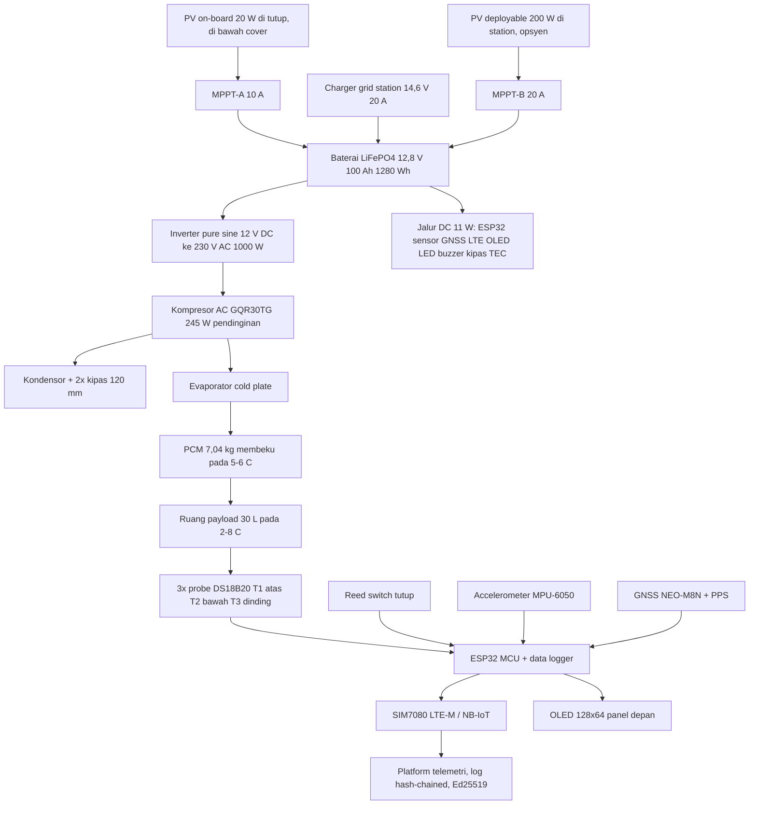

# detailIndo.md — Dimensi dan perhitungan (revisi ringkas · pembaruan tenaga kompresor AC)

> Versi bahasa Indonesia dari `detail.md`. Semua angka identik dengan versi Inggris; jika ada perbedaan, `detail.md` yang berlaku.
> Revisi ini menggantikan sistem tenaga kompresor DC 12 V sebelumnya dengan kompresor AC 220–240 V (GQR30TG) yang disuplai baterai LiFePO₄ 12,8 V 100 Ah melalui inverter pure sine wave. Inti payload, isolasi, PCM, dan geometri cold box tidak berubah dan tetap tepat 30,0 L. Jika angka di sini berbeda dengan `Case_Study_5_Solution_Analysis.md` atau sketch wokwi, dokumen ini yang berlaku.
> Label: [benchmark] = angka dari brief. [estimate] = perhitungan sendiri, asumsi dinyatakan. [verify] = datasheet pabrikan wajib sebelum build.
> Notasi: titik (.) adalah pemisah desimal. En dash hanya muncul pada rentang teknis seperti 2–8 °C.

## 0. Konsep secara ringkas

Ruang payload ditetapkan 40 × 25 × 30 cm = 30,0 L [benchmark]. Semua lapisan lain dibangun mengelilinginya dan tidak ada yang menggerus volume itu. Vacuum insulation panel (VIP) 2,5 cm menjaga cold box tetap ringkas pada 45,8 × 33,4 × 38,3 cm.

Sistem tenaga berubah pada revisi ini:

| | Revisi sebelumnya | Revisi ini |
|---|---|---|
| Kompresor | DC 12/24 V, kelas BD35F | **GQR30TG, AC 220–240 V, pendinginan 245 W** [verify] |
| Jalur daya | baterai → kompresor (DC) | baterai → **inverter 12 V DC → 230 V AC** → kompresor |
| Baterai | LiFePO₄ 12 V 20 Ah (240 Wh) | **LiFePO₄ 12,8 V 100 Ah (1.280 Wh)** |
| Panel surya | 200 W, terpisah di station | **20 W ringkas, direkatkan di atas tutup, di bawah cover pelindung** |
| Charging station | PV via MPPT | **charger AC grid (baseline) atau PV deployable (opsyen)**; PV on-board hanya trickle/range extender |
| MPPT | 20 A | **10 A (PV on-board) + 20 A (input PV station)** |

Kotak tetap dua tier bertumpuk vertikal:
- **Cold box (tier 2, atas):** ruang payload terisolasi dengan tutup, pelat PCM, evaporator, kipas sirkulasi.
- **Machine tier (tier 1, bawah):** kompresor AC, kondensor, baterai 100 Ah, inverter, MPPT, panel sekring, elektronik.

Identitas warna: **badan abu-abu arang gelap (RAL 7021)** dengan **garis aksen Sunlight Yellow (RAL 1023)**. Liner interior food-grade putih pucat. OLED dan LED di depan memberi status tanpa membuka tutup. Warna gelap menyerap lebih banyak matahari daripada warna terang; baris solar gain di §3.4 dihitung untuk kulit gelap ini, dan SOP menambahkan parkir di tempat teduh serta aturan terpal.

## 1. Diagram sistem



## 2. Langkah 1: ruang payload

40 cm × 25 cm × 30 cm = 30.000 cm³ = **30,0 L** [benchmark].

Alasan bentuk ini: tinggi 30 cm memuat tiga tray vaksin bertumpuk (masing-masing ≤ 90 mm), lebar 25 cm masih terjangkau dari satu sisi, dan rasio panjang 1,6:1 tetap stabil di atas perahu atau motor.

Pelat PCM berada di antara payload dan liner, liner membungkusnya, dan isolasi serta kulit luar berada di luar liner. Setelah dirakit, ruang guna tetap 40 × 25 × 30 = 30,0 L. Inti ini kendala keras; dinding yang menyesuaikan, bukan sebaliknya.

**Tutup:** bukaan 415 × 285 mm, engsel belakang di sisi panjang, membuka ke atas ~120° dan tetap terbuka tanpa penyangga. Ditutup dua latch stainless cam-action (dilepas bersamaan) dan diamankan hasp di tengah-depan untuk segel kawat atau gembok. Segel putus atau hilang ditandai sebagai custody event di hash chain. Tutup memakai gasket EPDM double-lip untuk kedap hujan IPX4.

**Warna liner interior:** PP natural food-grade (putih pucat, tanpa pigmen) untuk inspeksi higiene visual. Sachet silica gel 20 g diklip di sudut interior tutup, diganti tahunan.

## 3. Langkah 2: beban panas

### 3.1 Susunan dinding, dari dalam ke luar (tidak berubah)

| Lapisan | Ketebalan | Perannya |
|---|---|---|
| Payload | inti 30,0 L | volume itu sendiri |
| Pelat PCM (dua dinding panjang + lantai) | 13 mm | +1,3 cm ke Z, +2,6 cm ke Y |
| Liner, PP food-grade | 2 mm per sisi | +0,4 cm per sumbu |
| Pelat evaporator | 12 mm | lantai saja, di bawah PCM |
| Panel VIP | 25 mm per sisi | +5,0 cm per sumbu |
| Kulit HDPE | 2 mm per sisi | +0,4 cm per sumbu |

### 3.2 Luas dinding (tidak berubah)

Rongga dalam (di dalam liner): 0,40 × 0,276 × 0,313 m
A_in = 2(0,40×0,276) + 2(0,40×0,313) + 2(0,276×0,313) = 0,221 + 0,250 + 0,173 = **0,644 m²**

Cold box eksternal: 0,458 × 0,334 × 0,383 m
A_out = 2(0,458×0,334) + 2(0,458×0,383) + 2(0,334×0,383) = 0,306 + 0,351 + 0,256 = **0,913 m²**

Luas rata-rata: A = √(0,644 × 0,913) = **0,77 m²**

### 3.3 Konduksi panas melalui dinding (tidak berubah)

Hambatan termal VIP: R = L / k = 0,025 / 0,0075 = **3,33 m²·K/W** (nilai k aged, dihitung untuk seluruh masa pakai).

```
Q = ΔT × A / R = 35 × 0,77 / 3,33 = 8,1 W
```

Tambah 15% untuk engsel, pengikat, dan jembatan termal kecil: **9 W** pada ambient desain 40 °C. Pada 42 °C (ΔT 37): **10 W**.

### 3.4 Total panas selama 24 jam pasif (daya mati)

| Sumber panas | Bekerja | Energi |
|---|---|---|
| Konduksi dinding | 9 W × 86.400 s | 778 kJ |
| Pembukaan tutup | 4 × 30 kJ | 120 kJ |
| Kipas dan sensor internal | 1 W × 86.400 s | 86 kJ |
| Solar gain pada kulit gelap | 4 W × 12 jam terpapar matahari | 173 kJ |
| Payload | didinginkan ke 4 °C di station | 0 |
| **Total** | | **≈ 1,16 MJ** |

Baris solar gain mengasumsikan kulit RAL 7021 (absorptansi surya α ≈ 0,9 [estimate]) dengan SOP parkir teduh. Kulit putih memangkas angka ini kira-kira setengahnya; warna gelap dipertahankan demi konsistensi identitas, dan margin PCM 34% menyerap selisihnya. Angka 30 kJ per pembukaan mencakup pemanasan permukaan dalam dan penanganan payload.

## 4. Langkah 3: PCM (tidak berubah)

```
m = Q / λ = 1.160.000 / 220.000 = 5,3 kg   (minimum teoretis)
```

| Pelat | Dimensi | Volume | Massa |
|---|---|---|---|
| A, dua dinding panjang (×2) | 40 × 31,3 × 1,3 cm | 1,63 L masing-masing | 2,44 kg masing-masing |
| B, lantai (×1) | 40 × 27,6 × 1,3 cm | 1,44 L | 2,15 kg |
| **Total** | | **4,70 L** | **7,04 kg** |

- Kapasitas dingin: 7,04 kg × 220 kJ/kg = **1.549 kJ** terhadap kebutuhan 1.157 kJ → **margin 34%**. Margin ini menutup penuaan PCM, hari 42 °C, pembukaan tutup ekstra, dan operator yang tidak disiplin seperti SOP.
- Salt hydrate, melt 5–6 °C, densitas 1,5 kg/L [verify λ dan stabilitas siklus terhadap datasheet pemasok].
- Total pelat 4,7 L dan hidup di zona dinding. Payload tetap 30,0 L.

**Pernyataan holdover:** ≥ 24 jam pasif adalah *estimasi yang hanya berlaku pada profil uji yang dinyatakan* — ambient 38–42 °C, payload didinginkan ke 4 °C, ≤ 4 pembukaan tutup, sensor sesuai rencana pemetaan suhu. Ini bukan jaminan sampai kualifikasi laboratorium dalam rencana validasi esai membuktikannya.

## 5. Langkah 4: mesin pendingin — GQR30TG via inverter

### 5.1 Apa yang diberikan datasheet dan apa yang tidak

| Parameter | Nilai | Status |
|---|---|---|
| Model | GQR30TG | diberikan |
| Tegangan rating | AC 220–240 V, 50/60 Hz | diberikan |
| Kapasitas pendinginan | 245 W | diberikan — **ini beban pendinginan, BUKAN input listrik** |
| Motor | 1/10 HP (≈ 75 W poros), RSIR | diberikan |
| Starter | PTC atau current relay | diberikan |
| Aplikasi | medium back pressure | diberikan |
| Daya listrik input | **tidak disediakan** | **[verify]** |
| Arus jalan / LRA | **tidak disediakan** | **[verify]** |
| Refrigeran + charge | **tidak disediakan** | **[verify]** |
| Kebutuhan kondensor | **tidak disediakan** | **[verify]** |

Logika skenario: 245 W diasumsikan rating pada kondisi medium-back-pressure (evap ≈ −10 °C, cond ≈ 45 °C). Pada titik desain kita (evap −8 °C untuk membekukan PCM 5–6 °C, cond 50–55 °C pada ambient 40 °C) kapasitas turun sedikit.

### 5.2 Skenario input listrik [estimate — tiga skenario, datasheet yang menentukan]

| Skenario | Daya input | COP pada desain | Kapasitas bersih (−10 W kebocoran) | Recharge PCM (1.549 kJ) | Energi harian (§6.5) |
|---|---|---|---|---|---|
| Optimis | 130 W | 1,69 | 212 W | 2,0 jam | 756 Wh |
| **Baseline** | **145 W** | **1,52** | **210 W** | **2,1 jam** | **810 Wh** |
| Pesimis | 180 W | 1,22 | 187 W | 2,3 jam | 928 Wh |

Arus awal: RSIR dengan starter PTC biasanya menarik 3–4× arus jalan selama 0,2–0,5 s. Pada baseline 0,65 A jalan [estimate], start ≈ 2,5 A AC ≈ 600 VA. Inverter tetap harus diukur terhadap LRA datasheet — ini item [verify] terpenting di seluruh rantai kelistrikan.

### 5.3 Mengapa AC bukan DC (tradeoff dinyatakan, tidak disembunyikan)

Kompresor DC akan melewati rugi ~10% inverter dan risiko surge-nya. Baseline GQR30TG dipertahankan karena murah, mudah diservis secara lokal, dan tersedia di wilayah target; penalti energinya sudah dihitung di §6 dan ditutup oleh pengisian station. Jika pilot menunjukkan inverter sebagai sumber kerusakan dominan atau margin energi terlalu tipis, jalan keluarnya adalah kompresor DC 12/24 V berkapasitas setara dengan baterai dan panel tidak berubah.

### 5.4 Penguatan kondensor

Panas yang dibuang = kapasitas + input ≈ 220 + 145 = **365 W** [skenario baseline].

| Spesifikasi | Nilai |
|---|---|
| Tipe | wire-tube, tembaga Ø6, 3 baris |
| Face | **280 × 150 mm**, di dinding Y+ machine tier |
| Permukaan kawat | ≈ 0,62 m², UA ≈ 35 W/K |
| Aliran udara dibutuhkan | ≈ 64 CFM melalui core |
| Kipas | **2 × 120 mm aksial** (65 CFM free air masing-masing), ≈ 90 CFM free |
| Daya kipas | 2 × 2,4 W = 4,8 W (jalur DC) |
| Interlock | firmware tidak akan menjalankan kompresor saat tach membaca nol |

### 5.5 TEC trim (dipertahankan, sisi DC)

Modul Peltier 40 × 40 mm tetap sebagai cadangan DC: ia menahan kebocoran 10 W pada 42 °C selama ~31 jam hanya dengan baterai (COP 0,45 → 22 W listrik + 11 W beban DC = 33 W → 1.024 Wh / 33 W ≈ 31 jam). Ini cadangan sungguhan, bukan hiasan, dan membuat inverter boleh mati selama perjalanan pasif singkat.

## 6. Langkah 5: baterai, inverter, dan surya

### 6.1 Beban listrik

| Beban | Daya | Jalur |
|---|---|---|
| Elektronik: ESP32, sensor, GNSS, LTE, OLED, LED, buzzer | 5 W | 5 V DC |
| Kipas sirkulasi (cold box) | 1 W | 12 V DC |
| Kipas kondensor (2 × 2,4 W) | 4,8 W | 12 V DC |
| **Total DC** | **≈ 11 W → 264 Wh/hari** | |
| Kompresor via inverter | 145 W ÷ 0,90 inverter = **161 W sisi-DC** saat berjalan | |
| Standby inverter (eco) | 2 W [verify; idle biasa 6–12 W] | |

### 6.2 Baterai [estimate — dimensi dan massa wajib diverifikasi]

LiFePO₄ 12,8 V 100 Ah, 1.280 Wh nominal, **1.024 Wh guna pada DoD 80%**. Pak prismatik tipikal dengan BMS terintegrasi: **329 × 172 × 214 mm, ≈ 10,5 kg** [verify terhadap produk terpilih]. BMS discharge kontinu ≥ 100 A menutup tarikan rata-rata 13 A dengan margin lebar; arus charge 30 A = 0,3C masih di dalam batas biasa 0,5C.

### 6.3 Penentuan inverter

| Parameter | Nilai | Catatan |
|---|---|---|
| Topologi | pure sine wave, 12 V DC → AC 220–240 V 50 Hz | |
| Rating kontinu | 1.000 W | kandidat baseline |
| Kebutuhan surge | ≥ 1.500 VA, idealnya 2.000 VA | menutup start RSIR sampai LRA terverifikasi [verify] |
| Efisiensi pada beban 15–20% | target ≥ 88% | unit 1.000 W beban ringan pada 145 W; periksa kurva part-load [verify] |
| Standby / eco | ≤ 2 W eco, 6–12 W idle biasa | auto-restart eco dengan kompresor yang bersele harus diuji [verify] |
| Dimensi / massa | ≈ 300 × 160 × 85 mm, 2,2 kg | [verify] |
| Proteksi output | RCD/GFCI 30 mA pada colokan AC; bonding output floating sesuai manual | keselamatan AC wajib, lihat §10 |

Unit kelas 800 W dengan surge ≥ 2.000 VA dan kurva part-load bagus adalah pasangan yang lebih tepat jika datasheet mengonfirmasi LRA rendah.

### 6.4 Skenario energi harian (duty kompresor 25% / 50% / 100%)

| Duty | Energi kompresor (sisi-DC, termasuk rugi inverter) | Idle inverter | Beban DC | Total/hari |
|---|---|---|---|---|
| 25% (6 jam) | 1.000 Wh | 96 Wh | 264 Wh | 1.360 Wh |
| 50% (12 jam) | 2.000 Wh | 48 Wh | 264 Wh | 2.312 Wh |
| 100% (24 jam) | 4.067 Wh | 0 | 264 Wh | 4.331 Wh |

Pada 1.024 Wh guna, baterai menutup duty 100% selama ≈ **6 jam** — pull-down penuh dari suhu hangat di lapangan bukan tugas baterai; itu terjadi di station (grid atau surya), seperti sebelumnya.

**Duty desain jauh di bawah angka-angka ini.** Setelah PCM membeku, kompresor hanya mengganti kebocoran: duty ≈ 10 / 210 ≈ **5%** pada 42 °C. Baris 25/50/100% di atas adalah batas sensitivitas, bukan titik operasi.

### 6.5 Energi hari operasi (protokol: recharge di station, transit pasif-PCM dulu)

| Fase | Durasi | Energi (sisi-DC) |
|---|---|---|
| Recharge PCM di station (kompresor 100%) | 2,1 jam | 145 × 2,1 ÷ 0,90 = **338 Wh** |
| Transit, kompresor bersele pada duty 5% | 22 jam | 145 × 22 × 0,05 ÷ 0,90 = **177 Wh** |
| Standby eco inverter selama transit | 22 jam | 2 × 22 = **44 Wh** |
| Beban DC (selalu) | 24 jam | **264 Wh** |
| **Total, hari normal** | | **≈ 823 Wh → dibulatkan 810–830 Wh** |

Hari ekstrem (42 °C, duty 5,5%, +10% pembukaan tutup): **≈ 900 Wh**.

### 6.6 Otonomi tanpa matahari atau grid

| Strategi | Tarikan | Otonomi pada 1.024 Wh |
|---|---|---|
| Holdover pasif + telemetri saja (inverter OFF) | 11 W | **94 jam ≈ 3,9 hari** |
| Pemeliharaan kompresor aktif (inverter eco) | ≈ 34 W rata-rata | **30 jam** |
| Aktif, kompresor pesimis 180 W | ≈ 41 W rata-rata | **27 jam** |
| Cadangan TEC saja (kompresor gagal) | 33 W | **31 jam** |

Janji 24 jam [benchmark] sendiri bertumpu pada PCM, bukan baterai — angka baterai di atas adalah resiliensi multi-hari di atas janji itu.

### 6.7 Neraca surya — PV ringkas on-board + charging station

Footprint kotak (458 × 334 mm) membatasi panel on-board pada ≈ 25 W teoretis. Baseline menetapkan **panel semi-flexible mono 20 W (≈ 440 × 320 × 3 mm, ≈ 0,7 kg [verify])** yang direkatkan di permukaan atas tutup di bawah cover pelindung. Ini mengubah arsitektur surya secara jujur:

| Sumber | Energi ke baterai | Peran |
|---|---|---|
| On-board 20 W (4,5 PSH × 0,8 × 0,9) | **≈ 65 Wh/hari** | menopang telemetri + top-up lambat selama transit dan penyimpanan |
| Charger grid station 14,6 V / 20 A (baseline) | terbatas grid | recharge PCM (338 Wh dalam ≈ 2 jam) + top-up harian penuh |
| PV deployable 200 W lipat di station (opsyen) | ≈ 648 Wh/hari | operasi station tanpa grid |

**Putusan dinyatakan terang: panel on-board tidak akan pernah bisa menyalakan sistem kompresor AC.** Kebutuhan harian ≈ 810 Wh; 65 Wh menutup ≈ 8%. Recharge PCM dari panel on-board saja butuh ≈ 5 hari matahari. Nilai sebenarnya:

| Strategi | Tarikan bersih | Otonomi pada 1.024 Wh |
|---|---|---|
| Pasif + telemetri, panen PV on-board | 264 − 65 = **199 Wh/hari** | **≈ 5,1 hari** (naik dari 3,9) |
| Pemeliharaan aktif, panen PV on-board | ≈ 745 Wh/hari | ≈ 33 jam (naik dari 30) |

Karena itu charging station adalah **infrastruktur wajib**, bukan opsyen: charger AC grid adalah baseline (paling murah, kebal cuaca, recharge 2 jam); kit PV lipat 200 W deployable adalah alternatif tanpa-grid untuk station yang gridnya tidak andal. MPPT tunggal 30 A pada revisi sebelumnya diganti dua kontroler kecil — unit 10 A untuk panel on-board dan unit 20 A dari konektor PV eksternal untuk kit deployable (kedua input tidak pernah diparalel; nilai Vmp-nya berbeda).

### 6.8 Proteksi kelistrikan dan pengkabelan

| Item | Spesifikasi |
|---|---|
| Sekring utama baterai | 40 A (MEGA/ANL) di terminal baterai |
| Sekring cabang inverter | 30 A; kabel **10 mm²** (8 AWG), jalur ≤ 0,5 m |
| Sekring cabang MPPT | 30 A; sekring sisi PV 15 A |
| Distribusi DC | rel sekring blade 15 A untuk 11 W beban DC |
| BMS | terintegrasi, ≥ 100 A kontinu [verify] |
| Input 12 V kendaraan | **elektronik saja** (sekring 5 A). Mengisi 100 Ah dari socket kendaraan tidak praktis; charger DC-DC 20 A opsional yang disambung ke alternator terdaftar sebagai aksesori, bukan baseline |
| Output AC | RCD 30 mA, bonding output floating sesuai manual inverter, ruang AC dipisahkan dari bay DC dan dari cold box |
| Polaritas / transien | Pemblokiran Schottky pada input PV, TVS pada rel 12 V (dipertahankan dari revisi sebelumnya) |
| Charger (opsyen) | charger AC-DC 14,6 V / 20 A untuk operasi grid di station; dengan transfer switch, kompresor dapat berjalan langsung dari grid tanpa melewati baterai |

## 7. Langkah 6: semua komponen, dengan kecocokan diperiksa

| # | Komponen | Dimensi (cm) | Massa | Penempatan |
|---|---|---|---|---|
| 1 | Ruang payload | 40 × 25 × 30 | — | inti |
| 2 | Pelat PCM A (×2) | 40 × 31,3 × 1,3 | 2,44 kg masing-masing | dinding panjang |
| 3 | Pelat PCM B | 40 × 27,6 × 1,3 | 2,15 kg | lantai |
| 4 | Liner | 2 mm | 0,7 kg | membungkus inti + PCM |
| 5 | Pelat evaporator + kipas 80 mm | 40 × 25 × 1,2 | 2,0 kg | di bawah pelat B |
| 6 | Panel VIP (6 sisi) | 25 mm | 0,9 kg | dinding |
| 7 | Kompresor GQR30TG | Ø13 × 16,5 t | 8,0 kg [verify] | lantai machine tier |
| 8 | Kondensor (face 280 × 150) + 2 kipas 120 mm | 28 × 34 t × 8 d | 1,9 kg | dinding Y+ machine tier |
| 9 | Baterai LiFePO₄ 100 Ah | 32,9 × 17,2 × 21,4 | 10,5 kg [verify] | lantai machine tier |
| 10 | Inverter 1.000 W PSW | 30 × 16 × 8,5 | 2,2 kg [verify] | di atas baterai, standoff karet |
| 11 | MPPT-A 10 A (PV on-board) + MPPT-B 20 A (PV station) | 16,8 × 10 × 3 + 12,3 × 9 × 3,5 | 0,8 kg [verify] | machine tier, ditumpuk di strip bebas |
| 11a | PV on-board 20 W semi-flexible | 44 × 32 × 0,3 | 0,7 kg [verify] | direkatkan di atas tutup, di bawah cover |
| 11b | Cover pelindung PV (berengsel, terkunci) | 46 × 33,6 × 0,2 + frame | 0,9 kg | di atas dek PV, engsel belakang |
| 12 | Kotak elektronik | 13 × 8 × 6 | 1,0 kg | machine tier |
| 13 | Panel sekring + RCD + colokan AC | — | 0,9 kg | ujung X+ machine tier |
| 14 | Kulit, frame, handle, latch, hasp | — | 6,0 kg | cangkang — RAL 7021 abu arang |
| 15 | Cangkang tier + separator (PUR 15 mm + alu 2 mm) | 45,8 × 33,4 × 1,7 | 2,6 kg | antara dua tier |
| 16 | Panel kontrol (OLED + LED + buzzer) | 9 × 5 | 0,15 kg | muka depan, kiri |
| 17 | Port input daya + cover karet | 5,5 × 2,1 barrel | 0,05 kg | muka depan, kanan |
| 18 | Katup penyama tekanan | ventilasi membran/duckbill Ø10–15 | 0,02 kg | dinding sisi atas cold box — menyamakan ΔP permukaan laut ↔ pegunungan (§10a) |

Ruang internal machine tier adalah 48 × 34 × 32 cm (53 L). Tata letak terverifikasi (lihat `dimension.md` §5) memuat semua bagian di dalam batasnya dengan saluran kabel tersisa. Baterai setinggi 214 mm menentukan tinggi tier; inverter mengendarai di atasnya pada standoff karet agar terminalnya tetap terjangkau.

Rekap massa: cold box 16,1 kg + dek PV 1,6 kg; machine tier ≈ 29,0 kg; sensor dan perangkat keras ≈ 1,2 kg. **Kosong ≈ 48 kg, ~63 kg dengan payload 15 kg.** Angkat dua orang ditambah basis trolley kini wajib, bukan opsional.

## 8. Langkah 7: dimensi hasil perakitan

```
        49 cm
   ┌────────────────────┐  ─┬─
   │ [PV+COVER]  1,0 cm │   │
   │  COLD BOX  38,3 cm │   │
   │  30 L payload, PCM │   │
   │  dinding VIP 2,5 cm│   │ 74,2 cm
   ├── separator 17 mm ─┤   │ total
   │  MACHINE  33,2 cm  │   │
   │  kompresor, bat    │   │
   │  100Ah, inverter,  │   │
   │  2x MPPT           │   │
   └────────────────────┘  ─┴─
        35 cm
```

| Item | Nilai |
|---|---|
| Cold box (tidak berubah) | 45,8 × 33,4 × 38,3 cm (58,6 L) |
| Dek PV + cover (di atas tutup) | ≈ 46 × 33,6 × 1,0 cm, menambah ≈ 1,0 cm tinggi |
| Machine tier | 49 × 35 × 33,2 cm (57 L) |
| Perakitan penuh | **49 × 35 × 74,2 cm ≈ 119 L**, footprint berundak |
| Payload, bersih | **30,0 L**, tidak tersentuh |
| Berat | **≈ 48 kg kosong**, ~63 kg termuat |
| Pusat gravitasi | rendah — baterai 10,5 kg di lantai tier; stabil di atas trolley |
| Kit charging station | **charger AC grid 14,6 V / 20 A (baseline, 1,2 kg)** atau PV lipat 200 W deployable (opsyen, ≈ 8 kg terlipat) — tetap di station |

## 8a. Spesifikasi warna dan finishing (tidak berubah)

| Permukaan | Warna | Spesifikasi |
|---|---|---|
| Kulit luar HDPE (semua sisi) | Abu arang gelap | RAL 7021, UV-stabilised |
| Garis aksen (atas cold box + atas machine tier) | Sunlight Yellow | RAL 1023, 5 mm |
| Liner PP interior | Putih pucat / natural | food-grade, tanpa pigmen |
| Latch, hasp, engsel | Silver brushed | SS 304 |
| Corner guard | Karet hitam matte | 70 Shore A |
| Bezel panel kontrol | Hitam matte | aluminium anodised |
| OLED | navy #001a33 / cyan #00ccff | SSD1306 128 × 64 |
| LED | hijau #00ff44 · merah #ff2200 · kuning #ffcc00 | konvensi ISO |
| Pelat PCM | Biru pucat | tergantung pemasok |

Kulit gelap menanggung ≈ 2 W gain surya-ekuivalen ekstra dibanding putih (sudah di dalam §3.4); jika pilot menunjukkan duty iklim panas di atas model, perbaikan termurah adalah varian kulit abu terang RAL 7035, bukan redesain.

## 9. Apa yang ditanggung sistem tenaga AC ini

Tiga hal, semuanya layak satu baris di esai.

Rugi konversi. Jalur baterai→inverter→motor berjalan ≈ 90% efisien di mana jalur DC lama ≈ 95% langsung. Itu ≈ 30–40 Wh/hari pada duty desain — nyata, dan ditutup oleh pengisian station.

Risiko surge dan part-load. Kompresor RSIR pada inverter adalah antarmuka paling rapuh di sistem: surge start harus berada di dalam rating surge inverter, dan inverter 1.000 W yang santai pada beban 15% membuang watt idle. Keduanya selesai dengan datasheet (LRA, kurva part-load, perilaku eco) — keduanya item [verify] teratas.

Berat dan volume. Baterai 100 Ah sendiri menambah ~8 kg dan ~14 L dibanding pak 20 Ah; kotak tumbuh dari 57,5 menjadi 74,2 cm tinggi dan dari ~29 menjadi ~48 kg kosong. Trolley bukan lagi opsi. Volume payload, perlu dicatat, tidak tersentuh.

Batas PV on-board. Panel yang muat di tutup adalah sumber trickle 20 W, bukan pembangkit — ia memperpanjang otonomi telemetri dari 3,9 menjadi ≈ 5 hari dan memangkas neraca harian, tetapi recharge PCM dan energi kompresor tetap tugas station. Cover menambah dua item [verify]: rugi transmisi lewat jendela transparan apa pun (hindari cover kaca; gunakan cover opak yang diangkat) dan penyegelan engsel/latch di udara asin. Pencurian adalah mode kegagalan yang senyap: panel direkat, cover terkunci, dan pembukaan cover adalah event yang tercatat.

## 10. Sensor, antarmuka pengguna, dan keselamatan AC

Pensensoran tidak berubah dari revisi sebelumnya: tiga probe DS18B20 (T1 tengah-atas, T2 tengah-bawah, T3 dinding tengah), DHT22 ambient, BMP390, MPU-6050, reed switch tutup, GNSS NEO-M8N dengan jam terdisiplin PPS, sampling 30 detik [benchmark], buffer 72 jam, alarm ≤ 30 detik lokal / ≤ 2 menit remote. BMP390 berfungsi ganda sebagai log ketinggian: tekanan di setiap catatan memicu event ALTITUDE HIGH di atas ambang yang bisa diatur (default 2.000 m) — lihat §10a.

Panel depan (tanpa membuka tutup): OLED status 4 baris, LED hijau/merah/kuning, buzzer ≤ 30 detik, port input 12 V DC dengan cover karet berlabel kuning.

**Tambahan keselamatan AC untuk revisi ini:**
- Sisi 230 V hanya ada di dalam machine tier antara inverter, RCD, colokan, dan kompresor — tidak ada kabel AC yang masuk cold box.
- Proteksi RCD 30 mA pada colokan; output floating inverter di-bonding sesuai manualnya.
- Label peringatan pada setiap panel lepas yang memaparkan terminal AC; tutup panel sekring dikunci sekrup, bukan bebas-alat.
- Bay kompresor tetap punya lubang drainase dan ventilasi mesh; ruang AC menambahkan pelindung tetesnya sendiri di atas elektronik.

## 10a. Operasi ketinggian dan tekanan (penggunaan pegunungan)

Amplop desain: permukaan laut sampai 3.000 m — mencakup rute dataran tinggi Indonesia (Dieng ≈ 2.093 m, kota dataran tinggi Papua ≈ 1.500–2.500 m). Machine tier sudah berventilasi (inlet + exhaust) sehingga menyamakan tekanan bebas; persoalan tekanannya ada pada cold box yang tersegel dan perangkat pendingin.

| Efek pada 2.000–2.500 m | Konsekuensi | Respons desain |
|---|---|---|
| Densitas udara −21% pada 2.000 m (tekanan turun ≈ 1,2 kPa per 100 m) → aliran massa kondensor turun | UA 35 → ≈ 29 W/K; suhu kondensasi +2–3 K; kapasitas pendinginan −10–20% pada 2.000 m (aturan praktis industri: kehilangan 5–10% per 1.000 m); duty naik sedikit | Dapat diterima di bawah 2.000 m dengan monitoring duty; rating ketinggian kompresor [verify]; di atas 2.500 m pakai varian kondensor uprated |
| Batas kompresor hermetik | Unit rumah tangga biasanya dinilai ≤ 2.000–3.000 m | [verify] rating ketinggian di datasheet GQR30TG |
| Tekanan cold box tersegel | Menutup hangat (30 °C) di permukaan laut lalu mendaki ke 2.500 m menyisakan ≈ +18 kPa di dalam → ≈ 2,1 kN angkat pada tutup 415 × 285 — latch, bukan gasket, yang menanggungnya | **Katup penyama tekanan** (komponen baru) menyamakan tekanan dalam hitungan detik sambil tetap IPX4; bukaan tutup untuk custody juga menyamakan tekanan |
| Kebalikannya (tersegel dingin di ketinggian, lalu turun) | ≈ −9 kPa hisap di permukaan laut — tutup tersedak ke dalam, gasket termampatkan | Katup yang sama menyelesaikannya |
| Pelat PCM | Udara headspace mengembang, dinding pelat menggelembung | Headspace isi 10–15% + diafragma relief atau dinding bergerigi [verify dengan pemasok] |
| Elektronik | Sel LiFePO₄ teruji tekanan rendah UN38.3; PCB aman | Clearance 230 V terderating di atas 2.000 m per IEC 60664 [verify untuk deployment dataran tinggi] |
| Keuntungan termal — dan ini menang | Ambient pegunungan ≈ 15–25 °C → kebocoran panas turun ke ≈ 4–5 W (dari 9–10 W); bahkan setelah derate densitas, suhu kondensasi pada hari 22 °C di dataran tinggi hanya ≈ 34 °C vs ≈ 50 °C kasus terburuk permukaan laut | Holdover melampaui 24 jam dengan leluasa; duty kompresor turun — ketinggian bersahabat secara termal |

**Komponen baru:** katup penyama tekanan — tipe membran (kelas GORE PolyVent) atau duckbill, Ø10–15 mm, terpasang di dinding sisi atas cold box (atau frame tutup), kompatibel IPX4, menutup sendiri. Satu katup cukup untuk volume ini.

**Sinergi telemetri:** BMP390 yang sudah ada di BOM mencatat tekanan absolut di setiap catatan — berfungsi ganda sebagai log ketinggian. Firmware menambahkan event **ALTITUDE HIGH** di atas ambang yang bisa diatur (default 2.000 m), dan QA mendapatkan tekanan/ketinggian bersama setiap catatan ekskursi — ekskursi rute pegunungan menjadi bisa dijelaskan, bukan misterius.

> Sumber: kurva tekanan atmosfer standar (≈ −1,2 kPa per 100 m, formula barometrik); data lapangan cabinet-AC dataran tinggi (kehilangan pendinginan ≈ 5–10% per 1.000 m); derating listrik di atas 2.000 m (panduan Schneider Electric, IEC 60664). Embraco/Nidec menerbitkan buletin teknis khusus "High Altitude Effects on Refrigeration Systems" — minta bersama datasheet GQR30TG.

## 11. Tambahan glosarium

| Istilah | Arti |
|---|---|
| RSIR | Motor Resistance-Start Induction-Run; start via PTC atau current relay, menarik surge start beberapa kali arus jalan |
| Starter PTC | Resistor positive-temperature-coefficient yang keluar dari rangkaian setelah start; sederhana dan umum pada kompresor rumah tangga |
| LRA | Locked-Rotor Amps — arus start terburuk; rating surge inverter harus menutupnya |
| DoD | Depth of discharge; desain memakai 80%, yaitu 1.024 Wh guna dari 1.280 Wh |
| PSW | Output inverter pure sine wave, diperlukan motor RSIR dan proteksi RCD |
| MPPT | Maximum-power-point tracker; kelas 10 A untuk panel 20 W on-board, 20 A untuk kit PV station |
| Transfer switch | Pengalih yang menyuplai kompresor dari grid di station, melewati inverter dan baterai |

## 12. Datasheet dan data yang wajib Anda verifikasi

1. **Kompresor GQR30TG**: input listrik pada kondisi desain, arus jalan, LRA, jenis dan charge refrigeran, kebutuhan kondensor, massa, dimensi. Semua di §5 adalah skenario sampai ini datang.
2. **Baterai 100 Ah**: dimensi persis, massa, tata letak terminal, batas kontinu/puncak BMS, cycle life pada DoD 80%.
3. **Inverter**: rating surge dan durasinya, kurva efisiensi part-load, tarikan no-load, perilaku auto-restart eco dengan beban motor induksi.
4. **PV on-board 20 W semi-flexible**: dimensi vs dek 440 × 320 mm, massa, radius lentur vs kerataan tutup, toleransi output, spesifikasi lem perekat.
5. **Cover PV**: rating IP engsel dan latch, kompresi seal cover, rugi transmisi bila jendela dipakai.
6. **MPPT-A 10 A / MPPT-B 20 A**: PV Voc maksimum, konsumsi sendiri, profil charge vs spesifikasi baterai.
7. **Charger grid station**: profil 14,6 V / 20 A vs spesifikasi BMS baterai.
8. **PV deployable 200 W (opsyen)**: dimensi terlipat, massa, standar konektor.
9. **Pemasok PCM**: panas laten, densitas, toleransi titik melt, stabilitas siklus.
10. **VIP**: sertifikat k aged.
11. **Modul RCD/colokan**: rating dan rating IP untuk lingkungan machine tier.
12. **Rating ketinggian kompresor**: plafon operasi terverifikasi untuk GQR30TG (amplop target ≤ 3.000 m).
13. **Pelat PCM**: headspace pengisian dan spesifikasi relief tekanan untuk transportasi ketinggian.
14. **Katup penyama tekanan**: aliran udara, rating IP, masa pakai membran.

Hitung ulang sendiri luas, nilai R, neraca energi, dan margin sebelum esai mengutipnya. Konfirmasi setiap dimensi terhadap datasheet asli — tata letak tier bergantung padanya. Ungkapkan penggunaan bantuan AI jika aturan penyelenggara mensyaratkannya.
