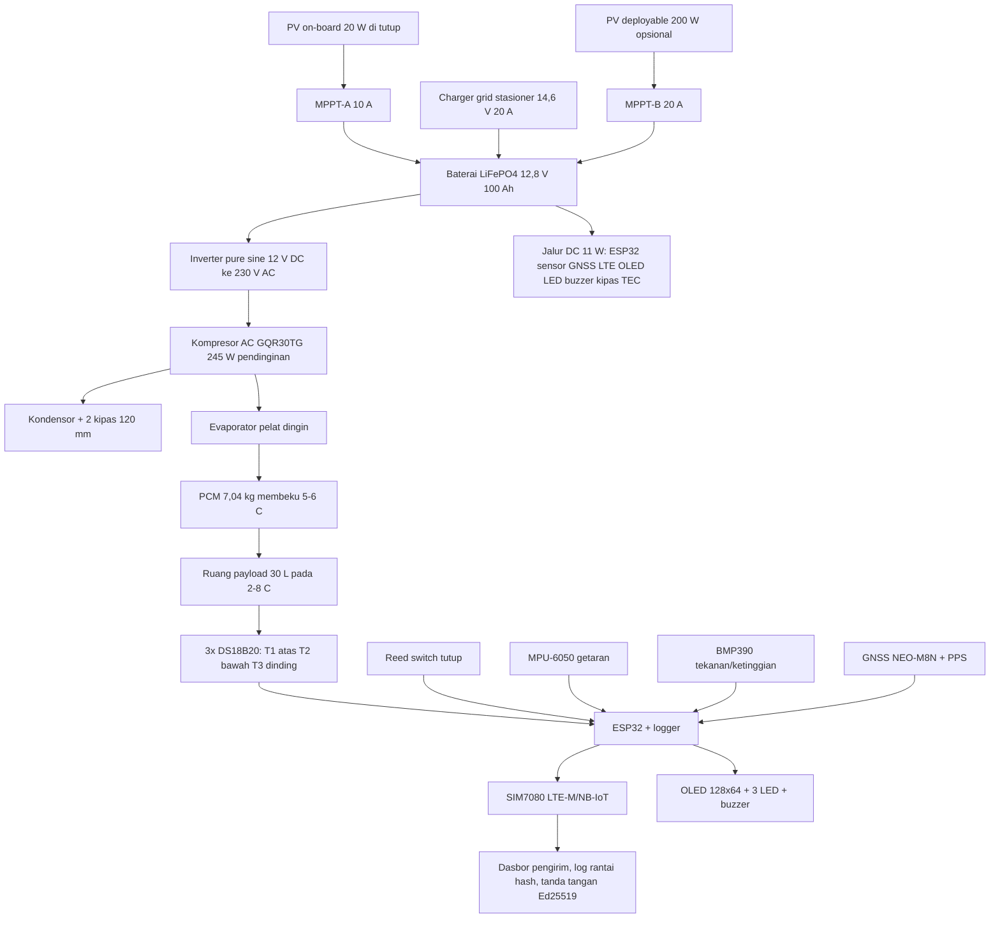

# YELODING: kotak rantai dingin hibrida PCM dan kompresor dengan log suhu offline untuk menjaga vaksin 2–8 °C selama 24 jam hingga pulau terpencil

*International Student Essay Challenge, Case Study 5: Smart IoT-Enabled Solar Cold Storage Unit for Medical & Vaccine Supply Chains. Universitas Wahid Hasyim, Universitas Muria Kudus, Cavite State University. Grup 5. Nama produk: YELODING, dari "yelo" (es, bahasa Tagalog) dan "dingin" (bahasa Indonesia), dengan bunyi "ding!" dari alarmnya; dibaca ye-lo-ding.*

> **Catatan pengiriman.** Brief penyelenggara mensyaratkan esai dalam bahasa Inggris, format A4, Times New Roman 12 pt, spasi 1,5, margin 2,54 cm, PDF, sitasi APA 7 (Panitia ISEC, 2026). Dokumen ini adalah versi bahasa Indonesia untuk kerja tim; terjemahan mengikuti struktur dan sitasi yang sama. Semua angka diberi label: **[benchmark]** berasal dari brief, **[estimate]** adalah hitungan tim dengan asumsi yang dinyatakan, **[sim]** sudah diverifikasi di simulasi Wokwi, dan **[verify]** masih menunggu datasheet pabrikan. Dokumen ini bukan spesifikasi alat medis tervalidasi (Panitia ISEC, 2026).

## Ringkasan eksekutif

**Masalah.** Vaksin, reagen biologis, dan pasokan medis sensitif suhu harus diangkut pada 2–8 °C. Di pulau kecil dan daerah pesisir, produk sering rusak sebelum sampai karena listrik padam, kotak dibuka berkali-kali, panas luar tinggi, dan perjalanan panjang (Panitia ISEC, 2026). Kerusakan ini tidak terlihat: vaksin tampak normal tetapi perlindungannya berkurang. Dampaknya nyata. Sepanjang 2025 Indonesia mencatat 63.769 kasus suspek campak dan 69 kematian, dan di Sumenep 16 dari 17 anak yang meninggal tidak pernah diimunisasi (Kementerian Kesehatan RI, 2025; WHO Indonesia, 2026).

**Solusi.** Kami mengusulkan YELODING, kotak vaksin 30 L [benchmark] berarsitektur hibrida. Selama perjalanan, PCM dan isolasi vakum menahan suhu tanpa listrik minimal 24 jam [benchmark]. Di titik stasioner, kompresor uap AC GQR30TG membekukan ulang PCM dalam sekitar dua jam. Tenaga berasal dari baterai LiFePO4 100 Ah lewat inverter pure sine, dengan panel surya 20 W di atas tutup sebagai pengisi tambahan. Lapisan pemantauan terdiri dari tiga probe suhu, sensor ambient, sensor tekanan, akselerometer, sensor tutup, GNSS, OLED, tiga LED, dan buzzer yang bekerja sepenuhnya lokal. Log suhu dirantai dengan hash dan ditandatangani perangkat, disinkronkan lewat LTE-M/NB-IoT saat jaringan ada. Aturan tata kelola ditegakkan perangkat: ekskursi kumulatif melewati 15 menit [benchmark] otomatis melatch status QUARANTINE sampai dirilis QA. Namanya dari "yelo" (es, Tagalog) dan "dingin" (Indonesia), dengan "ding!" sebagai bunyi alarm, memotret dua negara mitra dalam satu nama.

**Bukti.** Hitungan desain [estimate] menunjukkan kebocoran panas 9 W pada ambient 40 °C berkat VIP 25 mm, sehingga 7,04 kg PCM (1.549 kJ) menutup anggaran 24 jam sebesar 1,16 MJ dengan margin 34%. Logika kendali, alarm, anggaran PCM, rantai hash, dan alur karantina sudah diverifikasi dari ujung ke ujung pada simulasi Wokwi dengan delapan skenario uji (Grup 5, 2026d).

**Kesimpulan.** Pendekatan ini layak dan jujur terhadap batas fisika. Batas terbesarnya adalah bobot, sekitar 48 kg kosong, dan ketergantungan pada titik pengisian stasioner. Langkah berikutnya adalah uji *cold life* 24 jam di ruang 42 °C dengan sensor referensi terkalibrasi, lalu pilot lapangan.

## 1. Pendahuluan dan definisi masalah

Rantai dingin ibarat rantai sungguhan: kekuatannya ditentukan mata rantai terlemah. Di kota, mata rantai itu berupa lemari pendingin dengan listrik andal. Di pulau terpencil, mata rantai terlemahnya adalah kilometer terakhir: perjalanan dengan motor, perahu kecil, dan jalan kaki, di bawah matahari tropis, tanpa listrik yang pasti dan tanpa sinyal (Panitia ISEC, 2026). Pada segmen inilah suhu paling mudah menyimpang dan paling sulit dipantau.

Lingkup esai ini adalah vaksin imunisasi rutin yang disimpan pada 2–8 °C. Vaksin beku atau ultra dingin tidak termasuk. Kami memilih campak dan HPV sebagai contoh karena keduanya menunjukkan risiko yang berbeda. Vaksin campak rubela peka panas dan cahaya, sehingga lonjakan suhu di perjalanan adalah ancaman utamanya. Vaksin HPV peka pembekuan, sehingga suhu yang terlalu dingin di dekat bahan pendingin juga berbahaya. Desain yang aman bagi keduanya harus menjaga suhu di tengah rentang, bukan di tepinya.

Taruhannya besar. Sepanjang 2025 tercatat 63.769 kasus suspek campak, 11.094 kasus terkonfirmasi laboratorium, dan 69 kematian, naik 147 persen dibanding 2024 (Kementerian Kesehatan RI, 2025). Cakupan campak rubela dosis pertama dilaporkan turun dari 92 persen pada 2024 menjadi 82 persen pada 2025 (Media Indonesia, 2025). Wabah terparah terjadi di kantong berimunisasi rendah: di Kabupaten Sumenep, 16 dari 17 anak yang meninggal tidak pernah diimunisasi (WHO Indonesia, 2026). Untuk HPV, WHO mencatat sekitar 36.000 kasus baru kanker serviks dan 21.000 kematian per tahun di Indonesia, sekitar 70 persen terdiagnosis pada stadium lanjut, dengan target pemerintah 90 persen anak perempuan usia 15 tahun diimunisasi hingga 2027 (WHO & UNFPA, 2024). YELODING dirancang untuk segmen kilometer terakhir inilah: satu kotak yang dipercaya membawa vaksin menuju kantong-kantong itu.

Kerusakan akibat suhu berbahaya karena tidak terlihat. Vaksin yang terpapar panas atau beku tidak berubah warna dan tidak berbau. Anak menerima suntikan dan merasa terlindungi, padahal perlindungannya mungkin berkurang. Sebagian pihak menunjuk keraguan masyarakat sebagai pemicu utama kejadian luar biasa. Argumen kami lebih sempit: rantai dingin yang gagal memperburuk celah yang sudah ada, dan bukti suhu membantu membangun kepercayaan.

Pertanyaan utama esai ini mengikuti soal penyelenggara (Panitia ISEC, 2026): bagaimana sistem rantai dingin berbasis IoT dan tenaga surya menjaga kualitas vaksin, tetap bekerja saat listrik dan jaringan terputus, dan memberi catatan kustodi yang dapat dipercaya dengan biaya terjangkau bagi komunitas terpencil? Tesis kami mengikuti bingkai docx: PCM menanggung beban termal, kompresor stasioner menanggung pengisian ulang, surya kecil menanggung data, dan bukti menanggung kepercayaan.

## 2. Kebutuhan desain dan asumsi

### 2.1 Pemetaan benchmark penyelenggara

Tabel berikut membandingkan benchmark resmi brief (Panitia ISEC, 2026) dengan desain kami.

| Parameter | Benchmark [benchmark] | Desain kami | Status |
|---|---|---|---|
| Volume ruang simpan | 30,0 L | 30,0 L bersih (400 × 250 × 300 mm), tiga tray | Terpenuhi |
| Suhu kerja | 2,0–8,0 °C | Kendali histeresis 5–7 °C, alarm pada 8 °C | Terpenuhi [sim] |
| Ambient ekstrem | 38–42 °C | Desain 40 °C, uji 42 °C | Terpenuhi |
| Kalor laten PCM | > 220 kJ/kg | Salt hydrate 220 kJ/kg [verify datasheet] | Setara |
| Holdover pasif | ≥ 24 jam | 24 jam pada ΔT 35 K, margin 34% | [estimate, uji menyusul] |
| Interval sampling | 30 detik | 30 detik | Terpenuhi [sim] |
| Fallback seluler | LTE-M / NB-IoT | SIM7080, dua keduanya, plus buffer 72 jam | Terpenuhi |
| Ekskursi maksimum | 15 menit | Latch QUARANTINE otomatis | Terpenuhi [sim] |
| Akurasi GPS | 2,5 m | Target 2,5 m; diperkirakan 3–6 m antena samping | [estimate] |

### 2.2 Kriteria keberhasilan

Kriteria suhu kami lebih ketat dari batas aman: kendali bekerja pada pita 5–7 °C, sisanya untuk akurasi sensor dan keterlambatan respons. Kriteria peringatan: LED dan buzzer merespons dalam 30 detik lokal, telemetri terkirim dalam 2 menit saat tersambung. Kriteria tata kelola: ekskursi kumulatif di atas 15 menit melatch QUARANTINE sampai QA melepasnya, dan perangkat tidak bisa dilupakan petugas. Kriteria biaya: total per unit sekitar Rp 23,7 juta dengan kontingensi, dihitung di bagian 6.

### 2.3 Asumsi dan batasan

Asumsi kunci dan sensitivitasnya dinyatakan terbuka, sesuai tuntutan brief bahwa daya, kapasitas baterai, dan massa PCM tidak ditetapkan penyelenggara (Panitia ISEC, 2026). Enam asumsi paling berpengaruh: konduktivitas VIP 0,0075 W/m·K pada kondisi aged; input listrik kompresor 145 W dari rentang skenario 130–180 W; η inverter 0,90; harga energi Rp 1.500/kWh; ketersediaan grid di titik stasioner; dan buka tutup maksimal empat kali per perjalanan. Bagian 4.5 menunjukkan efek tiap asumsi.

Keputusan etika mengikuti batas brief: prototipe diuji dengan sensor referensi terkalibrasi dan protokol pemetaan suhu sebelum membawa vaksin nyata (WHO, 2011); kriptografi membuat catatan sulit diubah, tetapi tidak membuktikan sensor akurat atau petugas jujur; tidak ada data pengenal pasien yang disimpan, sesuai Undang-Undang Pelindungan Data Pribadi (Republik Indonesia, 2022) dan Data Privacy Act (Republic of the Philippines, 2012).

## 3. Arsitektur sistem dan justifikasi teknis

### 3.1 Diagram alur sistem

Brief menyajikan alur konsep tenaga surya, manajemen termal, ruang simpan, dan telemetri (Panitia ISEC, 2026). Kami mempertahankan alur itu dan menambahkan jalur pengisian stasioner serta kendali karantina.



### 3.2 Dua tier dan dimensi eksternal

Kotak terdiri dari dua tingkat. Tingkat atas adalah cold box 458 × 334 × 383 mm berisi payload, PCM, evaporator, dan isolasi. Tingkat bawah adalah machine tier 490 × 350 × 332 mm berisi kompresor, kondensor, baterai, inverter, MPPT, panel sekring, dan elektronik. Keduanya dipisah separator PUR 15 mm plus aluminium 2 mm. Footprint berundak karena baterai 100 Ah menentukan lebar; total tinggi 742 mm termasuk dek panel surya. Bobot kosong sekitar 48 kg, termuat dengan payload 15 kg sekitar 63 kg (Grup 5, 2026b). Catatan jujur soal bobot ada di bagian 4.3.

Susunan dinding dari dalam ke luar: PCM 13 mm pada dua dinding panjang dan lantai, liner PP food-grade 2 mm, VIP 25 mm, kulit HDPE 2 mm. Evaporator pelat aluminium 12 mm berada di lantai, di bawah PCM. Tutup 415 × 285 mm berengsel belakang, membuka sekitar 120 derajat, dengan gasket double-lip dan hasp segel tamper.

### 3.3 Panel surya dan titik pengisian

Brief memperbolehkan panel surya mengisi baterai atau mendukung pengisian stasioner tanpa harus terpasang di kotak (Panitia ISEC, 2026). Kami mengambil dua-duanya dengan porsi jujur. Panel on-board hanya 20 W (± 65 Wh per hari) karena footprint tutup membatasi, dan perannya hanya menopang telemetri. Pengisian besar adalah tugas titik stasioner: charger grid 14,6 V 20 A atau panel lipat 200 W untuk puskesmas tanpa grid. Argumen pentingnya panel besar di titik stasioner sudah kami perkuat dengan hitungan: panel semacam itu menambah panas pada kotak saat terik, jadi justru merugikan bila ditempel di badan kotak.

### 3.4 Peltier atau kompresi uap: dibandingkan, bukan diasumsikan

Brief meminta perbandingan kedua teknologi tanpa menganggap salah satu selalu unggul (Panitia ISEC, 2026). Tabel berikut merangkum perbandingan pada kondisi kerja kotak ini.

| Aspek | Peltier | Kompresi uap (GQR30TG via inverter) | PCM pasif |
|---|---|---|---|
| COP saat membekukan PCM | 0,3–0,6 | sekitar 1,5 [estimate, datasheet [verify]] | tidak berlaku |
| Daya listrik | 20 W (trim) | 145 W [estimate; rentang 130–180 W] | 0 W |
| Peran | cadangan DC bila inverter atau kompresor gagal, tahan sekitar 31 jam | pembekuan ulang di stasioner, pemeliharaan saat transit | penanggung utama 24 jam |
| Getaran dan bising | rendah | ada, diredam dudukan karet | tidak ada |
| Ketergantungan daya | DC langsung | AC via inverter | nol |
| Bagian bergerak | tidak ada | ada, titik kegagalan mekanis | tidak ada |

Kesimpulan perbandingannya kontekstual. Peltier cocok sebagai trim kecil daya rendah di jalur DC, dan itulah perannya di kotak ini. Kompresi uap unggul untuk memindahkan panas dalam jumlah besar per watt listrik, sehingga dipakai di titik stasioner dan sebagai pemelihara. PCM pasif unggul saat listrik tidak ada sama sekali, sehingga menjadi tulang punggung perjalanan. Ketiganya dipakai sesuai perannya.

### 3.5 Komponen pembawa mutu pada ruang payload

Titik leleh PCM dipilih 5 sampai 6 derajat, di atas 2 derajat sehingga tidak membekukan vaksin, di bawah 8 derajat sehingga masih menyimpan dingin. PCM ditempatkan di dinding dan lantai, tidak menempel pada vaksin. Boss jarak 10 mm membentuk saluran udara, kipas sirkulasi 80 mm meratakan suhu. Probe ditaruh dalam botol buffer berisi air atau glikol yang meniru massa termal vial, sehingga pembacaan mendekati suhu vaksin, bukan suhu udara ruang.

Mitigasi getaran mengikuti tuntutan brief (Panitia ISEC, 2026): kompresor di empat dudukan karet 30 Shore, kipas pada grommet, PCM di celah busa dengan boss jarak, elektronik dalam kotak terisi busa, empat tie-down eye M6 untuk pengikatan di kendaraan, akselerometer mengubah getaran berkelanjutan menjadi event tercatat.

Untuk operasi pegunungan sampai 3.000 m, dinding dilengkapi katup penyama tekanan. Tanpa katup, kotak yang disegel hangat di pantai lalu dibawa ke 2.500 m menyimpan kelebihan tekanan sekitar 18 kPa, setara 2,1 kN dorongan ke atas pada tutup (Wikipedia contributors, 2026). Katup menetralkannya dalam hitungan detik.

### 3.6 Keamanan data, waktu, dan teleimetri

Catatan tanpa waktu yang andal tidak dapat dipercaya. RTC DS3231 disinkronkan dari PPS GNSS; setiap record membawa flag sumber waktu; gap posisi dicatat sebagai GPS OUTAGE dan tidak pernah diinterpolasi. Sampling 30 detik [benchmark] menghasilkan sekitar 2.880 pembacaan per hari per sensor, puluhan kilobita per minggu, sehingga buffer 72 jam [benchmark] murah.

Setiap catatan dihubungkan hash catatan sebelumnya, FNV-1a pada simulasi, Ed25519 bertanda tangan pada perangkat nyata. Mengubah satu catatan lama memutus seluruh rantai setelahnya (Grup 5, 2026d). Log tersimpan lokal dengan pola store-and-forward dan disinkronkan lewat LTE-M atau NB-IoT saat jaringan ada. Tidak ada data pengenal pasien; posisi dipotong empat desimal sekitar 11 meter untuk peran non QA, sesuai kewajiban pelindungan data (Republik Indonesia, 2022; Republic of the Philippines, 2012).

Dasbor pemantauan menampilkan grafik suhu terhadap batas 2–8 °C, badge status, cadangan PCM, log peristiwa, rantai hash, dan peta rute. Dasbor dipagukan akses khusus pengirim karena broker publik demo dapat dibaca siapa saja; deployment nyata memakai broker terautentikasi dengan TLS dan kunci per perangkat. Perintah jarak jauh dicatat di rantai sebagai REMOTE CMD, sehingga kendali jarak jauh sepenuhnya dapat diaudit.

### 3.7 Alur kerja petugas

Petugas menerima kotak yang sudah diisi: PCM dingin, baterai penuh, segel utuh. Ia memuat vaksin, menekan tombol serah terima, lalu selama perjalanan cukup membaca warna lampu. Pengirim memantau peta dan suhu dari dasbor. Di tujuan, penerima memverifikasi struk hash, membuka segel, dan halaman status menampilkan suhu puncak serta durasi di luar rentang. Bila kotak melatch QUARANTINE, batch tidak boleh dipakai sebelum keputusan QA. Sistem menyajikan bukti; keputusan kelayakan tetap pada manusia dan pedoman WHO atau nasional.

## 4. Perhitungan utama dan pembandingan benchmark

### 4.1 Beban panas dominan dan pilihan desain yang paling menekannya

Pertanyaan pertama brief: apa beban panas dominan dan pilihan desain mana yang paling menekannya (Panitia ISEC, 2026)? Hitungannya berikut.

Asumsi [estimate]: cold box 458 × 334 × 383 mm, luas dinding rata-rata 0,77 m kuadrat, VIP 25 mm dengan k aged 0,0075 W/m·K sehingga R = 3,33 m kuadrat K/W, ambient desain 40 °C, target 5 °C.

```
Q = ΔT × A / R = 35 × 0,77 / 3,33 = 8,1 W
plus 15% jembatan termal  = 9 W
pada 42 °C (ΔT 37 K)     = sekitar 10 W
```

Konduksi dinding adalah beban dominan, sekitar 85 persen dari anggaran 24 jam. Pilihan desain yang paling menekannya jelas: VIP 25 mm. Versi awal tim memakai PUR 5 cm, beban 19 W, dan membutuhkan PCM 11 sampai 12 kg. VIP memangkasnya ke 9 sampai 10 W, dan PCM cukup 7,04 kg. Anggaran 24 jam lengkap: konduksi 778 kJ, pembukaan tutup 4 × 30 kJ, kipas dan sensor 86 kJ, solar gain kulit gelap 173 kJ, total sekitar 1,16 MJ.

### 4.2 Massa PCM dan margin yang pantas

Pertanyaan kedua: berapa PCM dan berapa margin yang pantas (Panitia ISEC, 2026)?

```
m = Q / λ = 1.160.000 / 220.000 = 5,3 kg   minimum teoretis
terpasang = 7,04 kg × 220 kJ/kg = 1.549 kJ
margin    = (1.549 - 1.160) / 1.160 = 34%
```

Margin 34% kami pilih untuk menutup penuaan PCM, hari 42 °C, pembukaan tutup ekstra, dan operator yang kurang disiplin. Margin lebih besar menambah bobot tanpa kebutuhan nyata; margin lebih kecil menghapus ruang kesalahan. Plat terpasang 7,04 kg duduk di zona dinding, sehingga payload tetap 30 L [benchmark].

### 4.3 Bobot: diklaim apa adanya

Total kosong sekitar 48 kg, termuat sekitar 63 kg. Itu tidak seringan kotak pengantar makanan, dan kami tidak akan mengklaimnya demikian. Definisi portabel kami jujur: angkat dua orang, trolley wajib, empat tie-down eye untuk pengikatan di motor atau perahu, pusat gravitasi rendah karena baterai di lantai tier. Draf awal menargetkan 18 sampai 20 kg, lalu ditinggalkan karena menuntut kompromi yang tidak jujur.

### 4.4 Anggaran energi dan otonomi

| Beban | Daya | Jalur |
|---|---|---|
| Elektronik, sensor, GNSS, LTE, OLED | 5 W | 5 V DC |
| Kipas sirkulasi + 2 kipas kondensor | sekitar 6 W | 12 V DC |
| Kompresor via inverter | 161 W sisi DC saat menyala | 145 W dibagi 0,90 |
| Standby inverter eco | 2 W | [verify] |

Hari operasi normal membutuhkan sekitar 810 Wh: recharge PCM 2,1 jam sebesar 338 Wh, transit dengan duty 5% sebesar 177 Wh, standby 44 Wh, beban DC 264 Wh. Hari ekstrem 42 °C sekitar 900 Wh. Otonomi dari 1.024 Wh guna (DoD 80%): 94 jam untuk pasif plus telemetri, sekitar 30 jam operasi aktif, 31 jam dengan TEC saja bila inverter gagal.

Skenario input kompresor diuji sensitivitasnya, sesuai permintaan brief (Panitia ISEC, 2026):

| Skenario | Input | COP | Energi harian | Otonomi aktif |
|---|---|---|---|---|
| Optimis | 130 W | 1,69 | 756 Wh | 32 jam |
| Baseline | 145 W | 1,52 | 810 Wh | 30 jam |
| Pesimis | 180 W | 1,22 | 928 Wh | 27 jam |

Panel on-board 20 W menyumbang sekitar 65 Wh per hari, cukup untuk menopang telemetri dan memperpanjang otonomi pasif menjadi sekitar lima hari. Ia tidak pernah cukup untuk pendinginan; itu tugas titik stasioner. Untuk mendung beruntun, baterai menjembatani sekitar 3,8 hari tanpa matahari.

### 4.5 Operasi dataran tinggi

Amplop desain sampai 3.000 m. Dua risikonya sudah dijawab. Pertama, tekanan: katup penyama menetralkan delta 18 kPa pada 2.500 m. Kedua, udara tipis: kapasitas pendinginan turun 10 sampai 20 persen pada 2.000 m, aturan praktis 5 sampai 10 persen per 1.000 m, tetapi ambient yang lebih dingin membuat suhu kondensasi tetap sekitar 34 °C, lebih baik daripada 50 °C di pantai. BMP390 mencatat ketinggian di setiap catatan dan memicu event ALTITUDE HIGH di atas ambang 2.000 m. Rating ketinggian kompresor menjadi item datasheet wajib (Embraco, 2019; Schneider Electric, 2011).

### 4.6 Tabel pembandingan benchmark

Sensitivitas terhadap tiga asumsi terbesar dirangkum berikut. Kebocoran panas 9 W berasal dari VIP; bila VIP gagal dan k naik ke 0,02, beban naik sekitar tiga kali dan janji 24 jam hangus, sehingga duty cycle kompresor dipantau sebagai detektor dini. Input kompresor 145 W punya rentang 130 sampai 180 W dengan efek otonomi 30 ke 27 jam, dan pengisian tetap mungkin di semua skenario. Harga energi 1.500 Rp/kWh hanya memengaruhi OPEX bulanan sebesar 36 ribu, tidak mengubah arsitektur.

## 5. Rencana operasional, analisis risiko, dan strategi validasi

### 5.1 Respons terhadap kegagalan

Brief menanyakan respons terhadap sensor rusak, tutup terbuka, baterai habis, sinyal hilang, dan rute tertunda (Panitia ISEC, 2026). Matriks berikut menjawabnya, dan baris yang bertanda sim sudah dijalankan di simulasi.

| Kegagalan | Deteksi | Respons otomatis | Prosedur manusia |
|---|---|---|---|
| Sensor rusak atau menyimpang | voting antar probe, cek laju perubahan | kanal ditandai, kendali pindah ke median | pasang probe cadangan terkalibrasi |
| Tutup terbuka | reed switch + laju suhu | buzzer 30 detik, drain PCM 1,3x, dicatat | SOP penutupan, catat di log [sim] |
| Baterai habis | pembagian tegangan | kuning di 11,0 V, kompresor dilepas di 10,5 V, prioritas ke log | kembali ke stasioner [sim] |
| Sinyal hilang | heartbeat timeout | store-and-forward, sinkron saat nyambung | tidak perlu tindakan, audit tetap utuh |
| Rute tertunda | GPS + estimasi holdover | peringatan sisa jam aman | alihkan ke titik serah terima terdekat |
| Kompresor gagal | tach nol, tren suhu | TEC 20 W menahan 31 jam | jam holdover berjalan, pengiriman pemulihan |
| Ekskursi > 15 menit | sampling 30 detik | latch QUARANTINE, ekspor bukti | keputusan QA [sim] |
| VIP bocor | tren duty cycle naik | peringatan dini sebelum janji 24 jam terancam | inspeksi panel di base stop |

### 5.2 Bukti untuk memutuskan batch setelah ekskursi

Saat latch QUARANTINE terpasang, kotak mengekspor paket bukti: kurva suhu lengkap, besaran dan durasi ekskursi, sensor mana yang membaca, peristiwa tutup, lintasan GPS, sumber waktu. Keputusan mengikuti label produk dan pedoman nasional atau WHO; VVM diperiksa untuk vaksin yang memilikinya. Bila bukti tidak cukup, putusan default adalah jangan dipakai. Lebih murah membuang satu batch daripada menanggung risiko pada satu anak.

### 5.3 Verifikasi lewat simulasi Wokwi

Sebelum satu komponen fisik dibeli, logika kendali dijalankan pada simulasi Wokwi: ESP32, dua DS18B20, DHT22, OLED, buzzer, tiga LED, tiga tombol, saklar daya, potensiometer baterai, tersambung ke broker MQTT publik dan dasbor web (Grup 5, 2026d). Delapan skenario uji semuanya lulus.

| # | Skenario | Kriteria lulus | Status |
|---|---|---|---|
| S1 | Operasi normal | OLED OK, PCM 100%, rantai bertambah, tanpa alarm | Lulus [sim] |
| S2 | Histeresis | kompresor nyala di 7 °C, mati baru di 5 °C | Lulus [sim] |
| S3 | Hilang daya | PASSIVE-HOLD, PCM terkuras sesuai delta T | Lulus [sim] |
| S4 | Tutup terbuka | event DOOR OPEN, drain PCM 1,3x | Lulus [sim] |
| S5 | Ekskursi karantina | 15 menit cerita, latch QUARANTINE | Lulus [sim] |
| S6 | Baterai lemah | kuning di 11,0 V, lepas kompresor di 10,5 V | Lulus [sim] |
| S7 | Serah terima | struk rantai hash untuk penerima | Lulus [sim] |
| S8 | Uji tamper | sunting satu catatan memutus rantai | Lulus [sim] |

Firmware simulasi dan perangkat nyata memakai struktur kendali yang sama. Yang berubah hanyalah perifernya: tiga probe, LTE-M nyata, GNSS nyata.

### 5.4 Validasi fisik

Rencana uji mengikuti tuntutan brief soal kalibrasi, latensi alarm, keseragaman suhu, holdover, dan integritas data (Panitia ISEC, 2026; WHO, 2011):

| Uji | Metode | Kriteria lulus |
|---|---|---|
| Cold life 24 jam | ruang 42 °C, sensor referensi terkalibrasi | suhu 2–8 °C selama 24 jam [benchmark] |
| Pemetaan suhu | sembilan titik sesuai WHO, 2011 | selisih titik terdingin dan terpanas di dalam pita |
| Kalibrasi sensor | pembandingan 0 °C dan 5 °C terhadap referensi ISO/IEC 17025 | deviasi <= 0,5 °C |
| Latensi alarm | injeksi ekskursi terkendali | lokal 30 detik, remote 2 menit |
| Holdover | penuh PCM, tanpa daya, 42 °C | >= 24 jam [benchmark] |
| Integritas data | uji tamper, ganti RTC, matikan jaringan | rantai putus terdeteksi, gap tercatat [sim] |
| Start kompresor | LRA nyata vs surge inverter | start 10 kali tanpa trip [verify] |
| Getar dan jatuh | profil shaker + 200 km jalan campur | tanpa gesekan plat, rantai utuh |
| Air dan korosi | semprotan garam, hujan tiruan | IPX4 tegak |
| Distribusi akurasi GNSS | P50 dan P95 di rute nyata | dilaporkan apa adanya, bukan nilai terbaik |

### 5.5 Data dasar kerusakan

Angka 25 persen yang kerap dipakai adalah hipotetis, bukan temuan (Panitia ISEC, 2026). Pilot akan memasang pencatat pada rute yang sudah berjalan selama beberapa minggu, lalu menghitung persentase perjalanan yang keluar dari 2–8 °C dan durasinya. Angka itu menjadi data dasar penilaian manfaat kotak, dan metode ini kami nyatakan sejak awal agar esai tidak menumpang angka karangan.

## 6. Dampak ekonomi, lingkungan, dan sosial

### 6.1 Anggaran per unit (harga terendah)

Brief menanyakan biaya penuh sepanjang masa pakai, termasuk penggantian baterai, kalibrasi, konektivitas, pemeliharaan, dan pelatihan (Panitia ISEC, 2026). Tabel berikut memakai harga terendah tiap komponen sebagai floor anggaran, kurs Rp 18.000 per USD (Grup 5, 2026c).

| Blok | Harga (Rp) | Sekitar USD |
|---|---|---|
| Cold box: shell, VIP, liner, PCM 7,04 kg, evaporator, gasket, latch, katup tekanan, cover PV, tray | 6.955.000 | 386 |
| Machine tier: kompresor GQR30TG, kondensor, baterai 100 Ah, inverter 1.000 W, MPPT ganda, panel 20 W, charger grid, TEC, sekring, shell | 9.270.000 | 515 |
| Elektronik dan telemetri: ESP32, 3x DS18B20, DHT22, BMP390, MPU-6050, OLED, SIM7080, GNSS, RTC, RCD, kotak elektronik | 1.895.000 | 105 |
| **Total BOM** | **18.120.000** | **1.005** |
| Perakitan, brazing refrigeran, kalibrasi awal, uji coba, pelatihan petugas | + 2.500.000 | + 139 |
| **Total per unit siap pakai** | **sekitar 20.620.000** | **sekitar 1.145** |
| Kontingensi 15% untuk fluktuasi harga baterai, inverter, VIP, kompresor | + 3.090.000 | + 172 |
| **Anggaran per unit untuk proposal** | **sekitar 23.700.000** | **sekitar 1.320** |

Panel PV deployable 200 W (Rp 2,4 juta) tidak masuk angka di atas karena sifatnya opsional; puskesmas diasumsikan punya grid.

### 6.2 Biaya sepanjang masa pakai

OPEX tahunan sekitar Rp 1,1 juta: listrik stasioner Rp 36 ribu per bulan (810 Wh per hari), kuota data Rp 300 ribu per tahun, silica gel Rp 25 ribu, kalibrasi Rp 150 ribu, servis ringan Rp 200 ribu. Penggantian baterai Rp 2,6 juta di tahun ke enam sampai tujuh. Total biaya kepemilikan lima tahun sekitar Rp 26,2 juta, sekitar Rp 435 ribu per bulan. Biaya pelatihan masuk di baris perakitan: setengah hari untuk operator, satu hari untuk teknisi fasilitas, satu hari untuk QA. Pembandingnya sederhana: satu pengiriman vaksin yang rusak bernilai jutaan sampai puluhan juta rupiah, ditambah hilangnya kepercayaan masyarakat.

### 6.3 Lingkungan

Tanpa bahan bakar dan generator, jejak karbon operasional rendah. Kompresor hanya berjalan sekitar 2,1 jam per siklus pengisian dan lima persen selama transit. Baterai LiFePO4 awet lebih dari 2.000 siklus dan lebih aman dari kimia lain, sesuai uji tekanan rendah UN 38.3 (United Nations, 2019). PCM dipakai ulang berkali-kali, refrigeran dalam charge kecil di bawah 110 gram sesuai regulasi. Daur ulang baterai dan PCM masuk prosedur pemeliharaan.

### 6.4 Privasi, peran, dan audit

Tidak ada data pengenal pasien di kotak maupun di log. Identifikasi pengiriman bersifat pseudonim. Posisi dipotong empat desimal untuk peran biasa dan lima desimal hanya untuk QA. Akses berbasis peran: kurir melihat pengirimannya sendiri, QA melihat tinjauan ekskursi, auditor hanya baca, dan setiap penimpaan manusia tercatat. Desain ini mengikuti UU Pelindungan Data Pribadi di Indonesia (Republik Indonesia, 2022) dan Data Privacy Act di Filipina (Republic of the Philippines, 2012), sejalan dengan tuntutan brief soal desain yang menjaga privasi sambil membuka audit resmi (Panitia ISEC, 2026).

### 6.5 Sosial dan kesehatan

Satu YELODING membawa vaksin untuk banyak anak sekaligus, termasuk kegiatan imunisasi sekolah. Setiap perjalanan yang aman berarti kelompok anak yang benar-benar terlindungi. Bukti suhu membantu petugas menjawab keraguan orang tua: mereka bisa melihat sendiri bahwa vaksin yang masuk ke anaknya tidak pernah keluar rentang. Jumlah dosis per kotak bergantung jenis vaksin dan kemasan; angka pastinya ditentukan saat pilot.

## 7. Keterbatasan dan rekomendasi

Keterbatasan yang kami nyatakan sendiri. Pertama, desain ini konseptual, bukan spesifikasi alat medis tervalidasi (Panitia ISEC, 2026). Kedua, bobot 48 kg menuntut dua orang dan trolley; di jalan setapak sempit ini tetap sulit. Ketiga, sistem bergantung pada titik pengisian stasioner; tanpa itu, kendali aktif hilang dan sistem kembali ke holdover pasif 24 jam. Keempat, data kompresor GQR30TG masih skenario sampai datasheet lengkap datang, terutama LRA terhadap surge inverter. Kelima, kriptografi melindungi catatan, bukan kenyataan: sensor bisa saja tidak akurat atau petugas lalai, sehingga kalibrasi dan segel fisik tetap wajib (Panitia ISEC, 2026).

Blockchain tidak kami pakai untuk sebagian besar kasus. Log berantai hash dengan tanda tangan perangkat sudah cukup mendeteksi manipulasi, dan simulasi membuktikannya. Blockchain baru relevan bila audit melibatkan banyak pihak yang saling tidak percaya, dan bahkan itu tidak membuktikan sensor akurat.

Rekomendasi. Bangun prototipe, jalankan uji 24 jam pada 42 °C dengan sensor referensi, verifikasi LRA kompresor terhadap surge inverter, lalu pilot lapangan di satu kabupaten kepulauan. Pemerintah dan mitra dapat membantu dengan titik pengisian di puskesmas, integrasi log ke sistem pelaporan imunisasi, serta dukungan kalibrasi dan pelatihan.

## 8. Kesimpulan

Jawaban atas pertanyaan utama adalah ya. Vaksin 2–8 °C dapat dijaga minimal 24 jam hingga pulau terpencil tanpa listrik andal dan tanpa internet, bila beban termal ditanggung PCM dan VIP, pengisian ulang ditanggung kompresor di titik stasioner, elektronik hanya mengawasi dan membuktikan, dan aturan 15 menit ditegakkan otomatis oleh perangkat itu sendiri.

Tiga temuan terpenting. VIP 25 mm memangkas beban panas dari 19 W ke 9 sampai 10 W sehingga 7,04 kg PCM cukup dengan margin 34%, dan harga fisikalnya adalah bobot sekitar 48 kg yang kami akui. Panel di atas kotak hanya cukup untuk elektronik, sehingga pengisian besar adalah tugas titik stasioner, dan kompresor AC murah lewat inverter adalah jalan paling realistis untuk membekukan ulang PCM dalam sekitar dua jam. Nilai terbesar sistem ini bukan pada pendinginnya, melainkan pada bukti suhu yang tahan manipulasi, alarm lokal yang bekerja tanpa jaringan, dan latch karantina yang menegakkan aturan 15 menit secara otomatis, semuanya sudah diverifikasi berjalan pada simulasi Wokwi sebelum satu komponen fisik dibeli.

Di pulau yang listriknya padam dan sinyalnya hilang, vaksin tidak boleh menunggu, dan petugas tidak boleh menebak. YELODING dirancang agar bekerja justru saat segalanya tidak ada, dan memberi petugas bukti, bukan sekadar harapan, bahwa vaksin yang ia suntikkan masih aman. Saat buzzer itu berbunyi "ding!", artinya ada yang perlu ditindak; saat diam, artinya rantai dingin masih utuh.

## Referensi

detikJateng. (2025, 26 Agustus). *Sumenep KLB campak, 17 meninggal, mayoritas belum pernah imunisasi*. https://www.detik.com

Embraco. (2019). *High altitude effects on refrigeration systems* [Buletin teknis]. Nidec Global Appliance. https://www.embraco.com

GS1. (2022). *GS1 EPCIS 2.0 standard*. https://www.gs1.org/standards/epcis

Grup 5. (2026a). *Detail.md: Dimensi dan perhitungan kotak rantai dingin* [Dokumen proyek internal].

Grup 5. (2026b). *Dimension.md: Lembar dimensi kotak rantai dingin* [Dokumen proyek internal].

Grup 5. (2026c). *Price.md: Rincian harga per komponen* [Dokumen proyek internal].

Grup 5. (2026d). *Wokwi: Simulasi ESP32 kotak rantai dingin, sketch.ino dan dashboard.html* [Kode proyek internal].

International Electrotechnical Commission. (2007). *IEC 60664-1: Insulation coordination for equipment within low-voltage systems, Part 1*. https://webstore.iec.ch

Kementerian Kesehatan RI. (2025). *Kemenkes waspadai dinamika campak nasional dan global*. https://kemkes.go.id

Kementerian Kesehatan RI. (2026). *Sehat negeriku: Bahan imunisasi HPV dan kanker serviks*. https://sehatnegeriku.kemkes.go.id

Media Indonesia. (2025, 27 Agustus). *KLB campak, IDAI: Imunisasi harus diperkuat*. https://mediaindonesia.com

Panitia International Student Essay Challenge. (2026). *Case study 5: Smart IoT-enabled solar cold storage unit for medical & vaccine supply chains (participant brief)*. UNWAHAS, UMK, CvSU.

Popmama. (2025). *Kasus campak di Indonesia tertinggi kedua di dunia*. (Rangkuman media atas data Kemenkes; verifikasi ke sumber primer sebelum dikutip.)

Republic of the Philippines. (2012). *Data Privacy Act of 2012 (Republic Act No. 10173)*. https://www.officialgazette.gov.ph

Republik Indonesia. (2022). *Undang-Undang Nomor 27 Tahun 2022 tentang Pelindungan Data Pribadi*. https://peraturan.bpk.go.id

Schneider Electric. (2011, 22 Maret). *Altitude derating* [FAQ teknis]. https://www.se.com

United Nations. (2019). *Manual of tests and criteria* (Rev. 7). https://unece.org

Wikipedia contributors. (2026). *Atmospheric pressure*. Wikipedia. https://en.wikipedia.org/wiki/Atmospheric_pressure

World Health Organization. (2011). *Annex 9: Temperature mapping of storage areas* (WHO Technical Report Series No. 961). https://www.who.int

World Health Organization. (2015). *Immunization in practice: A practical guide for health staff*. https://www.who.int

World Health Organization. (2024). *WHO PQS catalogue: Performance, quality and safety*. https://www.who.int

World Health Organization Indonesia. (2026, 9 Februari). *Sumenep successfully ended measles outbreak*. https://www.who.int/indonesia

World Health Organization & United Nations Population Fund. (2024, 15 November). *WHO, UNFPA commend Indonesia's efforts to eliminate cervical cancer*. https://www.who.int/indonesia

## Lampiran A. Tabel dimensi ringkas

| Parameter | Nilai |
|---|---|
| Ruang payload internal | 400 × 250 × 300 mm, 30,0 L bersih [benchmark] |
| Tray | 3 tray, masing-masing <= 90 mm |
| Bukaan tutup | 415 × 285 mm, engsel belakang, gasket double-lip |
| Cold box eksternal | 458 × 334 × 383 mm |
| Machine tier eksternal | 490 × 350 × 332 mm |
| Separator | PUR 15 mm + aluminium 2 mm |
| Total perakitan | 490 × 350 × 742 mm, sekitar 89 hingga 119 L |
| Bobot kosong / termuat | sekitar 48 kg / sekitar 63 kg dengan payload 15 kg |
| PCM | plate A 2 pcs (400 × 313 × 13) + plate B 1 pc (400 × 276 × 13), total 7,04 kg |
| Evaporator | Al 6063 400 × 250 × 12 mm, serpentin tembaga, kipas 80 mm |
| Kompresor | GQR30TG, Ø130 × 165 mm, 245 W pendinginan [verify] |
| Baterai | LiFePO4 12,8 V 100 Ah, 329 × 172 × 214 mm [verify] |
| Inverter | pure sine 1.000 W, 300 × 160 × 85 mm [verify] |
| Panel surya | 20 W semi-flexible 440 × 320 × 3 mm di atas tutup, cover pelindung berengsel |
| Ventilasi | exhaust 320 × 160 mm, inlet 200 × 60 mm |
| Panel kontrol depan | OLED 128×64 + 3 LED + buzzer, 90 × 50 mm |
| Perlindungan | IPX4 tegak, katup penyama tekanan untuk operasi 3.000 m |

## Lampiran B. Kelistrikan dan proteksi

| Item | Spesifikasi |
|---|---|
| Jalur DC tetap | 5 W elektronik + 6 W kipas = 11 W, 264 Wh per hari |
| Jalur AC kompresor | 145 W via inverter, 161 W sisi DC saat menyala |
| Baterai | LiFePO4 12,8 V 100 Ah, 1.280 Wh, 1.024 Wh guna pada DoD 80% |
| Inverter | pure sine 1.000 W, surge minimal 1.500 VA, efisiensi 0,90 |
| MPPT | A 10 A untuk PV on-board, B 20 A untuk PV stasioner |
| Sekring | 40 A utama baterai, 30 A inverter (kabel 10 mm kuadrat, maks 0,5 m), 30 A MPPT-B, 15 A PV, 15 A distribusi DC |
| Proteksi AC | RCD 30 mA, ruang AC terpisah dari jalur DC, label peringatan 230 V |
| Proteksi DC | TVS pada rel 12 V, dioda blok pada input PV, LVD 11,0 V dan 10,5 V |
| Pengisian | charger grid 14,6 V 20 A di stasioner; PV on-board 20 W sebagai tambahan; transfer switch untuk kompresor langsung dari grid |
| Waktu pengisian PCM | 1.549 kJ pada 210 W bersih, sekitar 2,1 jam |

## Lampiran C. Pemetaan benchmark ke implementasi Wokwi

| Benchmark brief | Implementasi di simulasi | Bukti |
|---|---|---|
| Sampling 30 detik | interval record 2 detik simulasi dengan SIM_SCALE 60, setara 30 detik waktu cerita | log serial [sim] |
| Holdover 24 jam | PCM_FULL_STORY_H = 24, drain sesuai delta T | S3 lulus [sim] |
| Ekskursi 15 menit | penghitung kumulatif, latch QUARANTINE | S5 lulus [sim] |
| Fallback seluler | MQTT ke broker publik, buffer store-and-forward | S8 lulus [sim] |
| Kustodi terverifikasi | rantai hash FNV-1a per record, struk serah terima | S7 dan S8 lulus [sim] |
| Peringatan lokal | OLED + 3 LED + buzzer tanpa jaringan | S2, S4, S6 lulus [sim] |

Pada perangkat nyata, hash FNV-1a diganti Ed25519 bertanda tangan, dua probe diganti tiga, dan MQTT WiFi diganti LTE-M. Struktur kendali tidak berubah.

*Pengungkapan integritas akademik. Analisis ini milik tim, dengan bantuan alat AI untuk penyusunan dokumen sesuai aturan penyelenggara (Panitia ISEC, 2026). Semua angka teknis diberi label benchmark, estimate, sim, atau verify; hasil simulasi adalah verifikasi logika, bukan hasil ukur perangkat fisik.*
